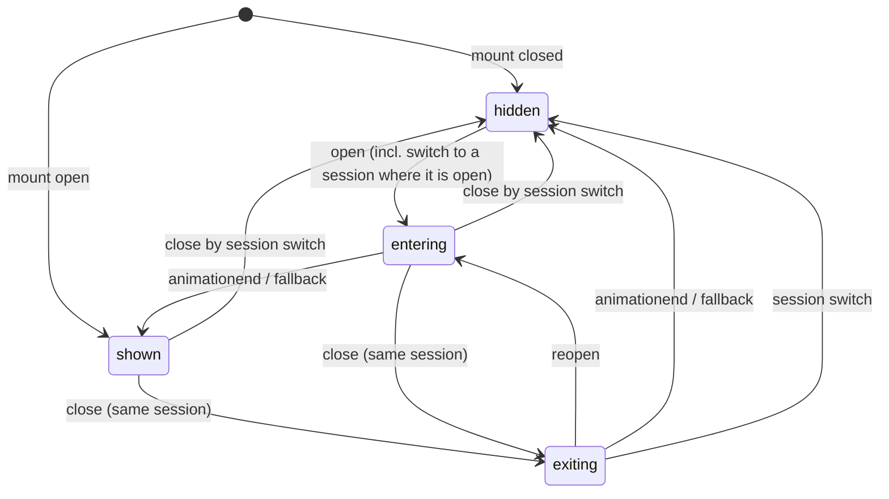

## Context

`QuakeTerminal` returns `null` while closed. A `rendered` flag trails `open` by a 200 ms timer so the exit keyframe can play. The user reports the slide as stuck and jerky. Code reading shows what runs during the 200 ms slide (12 frames at 60 Hz):

**On open (`Ctrl+}`):**
1. React mounts a new overlay `div`. WebKitGTK must create and paint a new compositing layer when the animation starts.
2. `setHost` re-parents every quake shell container into the new host. The canvases re-enter the document.
3. The ResizeObserver fires its first callback. One frame later, `fitActive("quake")` runs `fit` and a full `paintAll`.
4. The show effect calls `showShell`. For an existing entry, `showTerminal` schedules another `fit` + `paintAll` in the next frame.
5. One frame after the atom flip, `toggleQuake` calls `focusZone("quake")`. The overlay gets `border-primary`. The user config has `panel_glow: true`. `.nergal-panel-focus` then transitions a four-layer `box-shadow` (up to 28 px blur, 6 px spread) over 200 ms, on the same element that slides.

**On close:**
1. `toggleQuake` calls `focusZone("terminal")`. The overlay's glow transitions out while it slides. The agent pane under it transitions its own glow in. That pane is the "repainting subtree" the old comment names as the reason WebKitGTK skips the exit.
2. A 200 ms `setTimeout` unmounts the overlay. The exit keyframe also lasts 200 ms. If the animation starts one or two frames late, the unmount cuts the end of the slide.

A `transform` animation alone is composited. Per-frame `box-shadow` repaints and full canvas repaints are not. They force a layer content update on each frame, so the compositor frames stall and then jump.

## Goals / Non-Goals

**Goals:**
- A slide that animates only `transform` on a layer that exists before the slide starts.
- No layer creation, canvas re-parenting, re-fit or full repaint inside the slide window.
- No `box-shadow` or `border-color` transition inside the slide window.
- The exit slide always finishes before the overlay hides.
- Keep the scrollback and grid across close and reopen.

**Non-Goals:**
- No change to `Ctrl+}` semantics, shell lifecycle, persistence, or the backend.
- No new visual language. The glow, border, shadow, height and timing stay the same.
- No change to `.nergal-panel-focus` outside a slide.

## Decisions

### D1. Always-mounted overlay with a pinned layer

The overlay renders for the component's whole life. Closed means `transform: translateY(calc(-100% - 8px))` plus `visibility: hidden`. `will-change: transform` stays on in every phase, so WebKitGTK never drops or re-promotes the layer.

- *Alternative: keep mount/unmount, add `will-change` only.* The layer would still be created at each open, and the re-parent, re-fit and repaint work would stay in the slide window. Rejected.
- *Alternative: `display: none` when closed.* That removes the layer and the layout box. The canvases would lose their size, and `fit` on reopen would run again. Rejected.

### D2. Four-phase slide state machine

Phases: `hidden`, `entering`, `shown`, `exiting`. A pure function `nextSlidePhase` drives them, so the logic is unit-tested without a DOM.

`animationend` ends a slide. A timer at twice the slide duration is the fallback, in case WebKitGTK never fires the event. The old fixed timer equalled the slide duration, which caused the cut exit.

- *Alternative: keep a fixed timer.* Rejected: it races the animation start.
- *Alternative: discrete `visibility` inside the exit keyframe, no JS end event.* It would hide the overlay, but the transition freeze (D3) still needs to know when a slide ends. Rejected.

### D3. Freeze the focus transitions during a slide

While the phase is `entering` or `exiting`, CSS sets `transition: none` on `.nergal-panel-focus` for the overlay and for every panel after it (`.quake-enter ~ * .nergal-panel-focus`). The overlay is the first child of the content area, and `ResizablePanelGroup` is its next sibling. So the selector covers the sidebar, agent pane and right panel. The focus accent then changes in one frame and stays static while the layer moves.

- *Alternative: delay the focus change until the slide ends.* Keystrokes typed in those 200 ms would go to the previous zone. Rejected.
- *Alternative: move the glow to an opacity-animated pseudo-element.* It changes a shared class used by every panel. That is broader than this change needs. Rejected.

### D4. Register once, skip redundant reopen work

`setHost("quake")` and the ResizeObserver run once per mount. The show effect skips `showShell` when the requested shell is already the quake's active terminal (`terminalService.isActiveShell`). The grid stays painted while closed, because `applyUpdate` paints on every update and the ResizeObserver still fits on window resizes (`visibility: hidden` keeps the layout box).

### D5. Release focus when `open` turns false

`visibility: hidden` makes the overlay unclickable and unfocusable. A focused element can still keep focus in WebKit. Focus is released when `open` turns false, and an `exiting`/`hidden` overlay ignores pointer input. So when `open` turns false, the component blurs `document.activeElement` if the overlay contains it. It also resets a stale `quake` focus zone to `terminal`, because raw leader keys pick their PTY from that atom (`useKeyboardShortcuts.ts:80`). `toggleQuake` already does both on close; this covers the session-switch path.

## Risks / Trade-offs

- [The overlay subtree stays in the DOM while closed] → It is one div with N small containers. The canvases already lived in memory before, detached. Cost is negligible.
- [WebKitGTK still skips the exit over the spec panel's live-refresh repaint] → D1 and D3 remove the two causes found in code. The spec-panel case needs a manual walk to confirm. If it persists, it is a compositor limit outside this component.
- [`animationend` never fires] → The 2× fallback timer ends the phase.
- [The ResizeObserver now also fires while the quake is closed] → A window resize fits the quake's active shell at once, even when it belongs to another session. Its PTY then matches the size it gets on reopen, so reopen needs no fit. Accepted.
- [`will-change` pins a full-size layer for the app lifetime] → One extra texture of the overlay size. Not measured; the manual walk is the check.
- [WebKit may skip painting a `visibility: hidden` layer] → Then the first `entering` frame repaints once. That is still cheaper than today's layer build, re-parent and two full repaints. Tasks 3.2 and 3.3 verify it.
- [Close mid-enter or reopen mid-exit] → The new keyframe starts from its own `from` value, so the overlay jumps once. Same as before. Accepted.
- [Focus accent snaps instead of fading during a slide] → Only for 200 ms, and only for transitions that start inside the slide. Accepted.

## Migration Plan

Frontend-only. Ship in a normal release. Rollback is a revert of the change commit.

## Open Questions

None.

## Revision

Post-hoc plan review returned REVISE; three fixes:

1. Focus leak during the exit slide: `.quake-exit` stayed clickable, so a mousedown refocused the textarea and set the zone to `quake` after the release effect had run. `.quake-exit, .quake-hidden` now have `pointer-events: none`, and the overlay `onMouseDown` returns early when `open` is false.
2. CSI O on close: closing no longer runs `setHost(null, "quake")`, so the focus-out report depended only on the textarea `blur`, which WebKitGTK does not fire reliably when an ancestor hides. `terminalService.reportRegionUnfocused(region)` reports the region's active entry unless it has input focus, and the close effect calls it.
3. Late `animationend`: `nextSlidePhase` now takes the `animationName` on `animationEnd` and completes `entering` only for `quake-slide-down` and `exiting` only for `quake-slide-up`. The 2x fallback timer sends no name and completes unconditionally.
