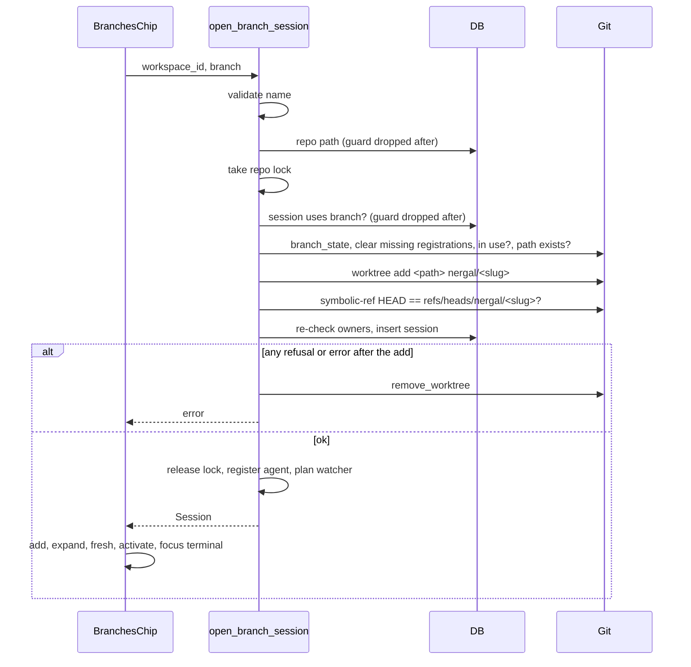
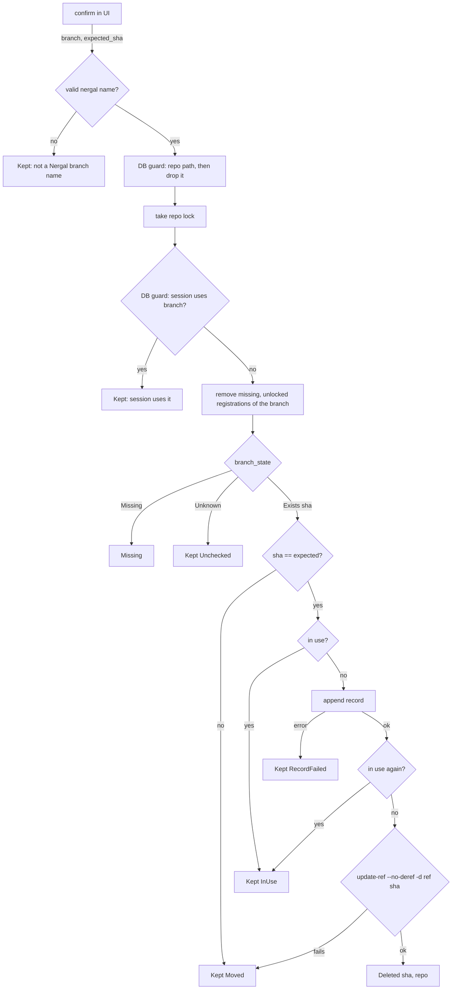

## Context

`session-delete-followups` made `delete_session` drop a session's branch only when it is safe (`drop_session_branch`, `src-tauri/src/worktree.rs:450`). Branches with commits that exist only on this machine stay, and nothing in the app shows them. The same happens when a worktree is removed outside Nergal: `reconcile_worktrees` clears `worktree_branch` (`src-tauri/src/db/sessions.rs:249`) and the branch is orphaned. Git also keeps the registration of a worktree removed with `rm -rf` (listed as `prunable`), so that branch counts as checked out until the registration goes away.

The git panel is session-scoped (`GitPanel` takes a `sessionId`) and organized as a chip strip (`src/stores/git.ts:84-94`, `src/components/git/chips/ChipStrip.tsx`). The PRs chip is the precedent for workspace data inside that strip: it receives `workspaceId` and caches in a plain atom keyed by workspace (`prsCacheMapAtom`, `src/stores/git.ts:131`).

There is no per-commit diff anywhere. `HistoryChip` lists a commit's files with `get_commit_files`, but opening one goes through `openZenMode` → `DiffView` → `get_file_diff`, which runs `git diff HEAD -- <file>` (`src-tauri/src/worktree.rs:757`). The commit hash is dropped (`HistoryChip.tsx:63`).

Constraints: Linux + Claude Code only (focus freeze). Sync `#[tauri::command]`s run on the main thread, so git work in a sync command freezes the UI. `db-lock-discipline` requires the DB guard to be dropped before slow work. The `html-escaping-contract` requires `escapeHtml` for user-controlled text in `confirm` bodies.

## Goals / Non-Goals

**Goals:**
- One place that shows every `nergal/*` branch with work that exists only on this machine, and which session (if any) owns it.
- Recover such a branch as a working session, or delete it with a restore record, with the same race guards as the safe drop.
- Correct per-commit diffs in History and Branches.

**Non-Goals:**
- Branches outside `refs/heads/nergal/`.
- Pushing, merging or rebasing from the chip.
- Restoring deleted branches from `deleted-branches.log` in the UI. The toast and the record carry the restore command.
- Actions on branches that a session uses: that session's own flows (delete session, ship) own them.
- Keyboard shortcuts for the actions. The chip uses the in-chip navigation keys of `HistoryChip` (↑/↓, j/k, Space) and focusable buttons. No new global binding.
- Taking the per-repository lock in the session-creation paths (`create_session`, Linear, ClickUp, MCP). They always create a new branch with a timestamped slug, so they cannot collide with an existing `nergal/*` branch.

## Decisions

### D1. The backend computes the list in one command

`list_local_branches(workspace_id)` reads the repo path and the workspace's branch owners under the DB guard, drops the guard, then runs git off the main thread. A workspace that is not a git repository returns an empty list.

- One `git for-each-ref refs/heads/nergal/ --format=<refname, objectname, symref, committerdate:unix, subject>` lists candidates. The full `refname` is used and `refs/heads/` stripped, because `refname:short` turns into `heads/nergal/x` when a tag with the same name exists. Rows with a non-empty `symref` are skipped.
- Per candidate, `git rev-list --count <sha> --not --remotes <target-ref> --` gives `pending`. The target is the owning session's `merge_target`, or `HEAD`, as in `branch_is_safe_to_drop` (`src-tauri/src/worktree.rs:376`). A git failure gives `pending: None` and the row stays. Rows with `pending == Some(0)` are dropped.
- One `git worktree list --porcelain` is parsed into worktree entries (path, branch, `locked`, `prunable`). A branch is `in_use` when an entry with an existing directory or a `locked` line holds it, or when it is being rebased or bisected (the same files `branch_checked_out` reads). A branch held only by `prunable`, unlocked entries gets `missing_worktree: Some(path)` instead.

Alternative: the frontend composes `list_branches`, per-branch calls and `workspacesAtom`. Rejected: N round trips, and the "no session" marker would come from frontend state that may be stale, while the actions re-check the DB anyway.

### D2. One per-commit diff command with an explicit scope

`get_commit_file_diff(scope, hash, file_path)` takes a `scope` of `{ kind: "session", sessionId }` or `{ kind: "workspace", workspaceId }`. The scope resolves the base directory exactly as the file lists do: the session cwd (`resolve_session_cwd`) for History, the workspace repo path for Branches. The command:

- refuses a `hash` that is not 4–64 hex characters, without running git;
- resolves it with `git rev-parse --verify --quiet <hash>^{commit}` and refuses unless the full id starts with `hash`. A branch named like a hash then never stands in for a commit;
- strips the base from `file_path` and refuses an absolute remainder or a `..` component, without running git;
- runs `git --literal-pathspecs diff-tree -p --no-color --no-commit-id --root -m --first-parent <full-id> -- <rel>`. This gives the first-parent diff, the full content for a root commit, and no pathspec magic.

`get_scoped_commit_files(scope, hash)` returns the commit's files joined to the base, with the same id checks. It replaces `get_commit_files`, which is removed with its registration, since `HistoryChip` is its only caller. `get_branch_commits(workspace_id, branch)` validates the name, then runs `git log --format=%h%x09%s -100 <sha> --not --remotes <target-ref> --`.

Alternative: add an optional `hash` to `get_file_diff`. Rejected: that command is session-only, and its fallback to `--no-index /dev/null` for untracked files makes no sense for a commit.

### D3. Zen carries an optional commit

`ZenModeState` gains `commit: { hash: string; scope: CommitScope } | null`. `openZenModeAtom` accepts it, and `closeZenModeAtom` resets it. When `commit` is set, `ZenMode` passes it to `DiffView`. `DiffView` then calls `get_commit_file_diff` instead of `get_file_diff` and skips the `fileTimestamp` refetch. `ZenMode` keys `DiffView` by `${hash}:${path}` and shows the short hash in the header. Callers pass only that commit's files as `files`, which fixes the flattened list in `HistoryChip.openCommitFileZen`.

Alternative: a separate commit-diff overlay. Rejected: Zen already has the viewer and sidebar zones, file navigation and keyboard ownership.

### D4. "Open session" is a dedicated command that never creates a branch

`open_branch_session(workspace_id, branch)`. The lock order is fixed (D6):

1. Validate the name: `nergal/<slug>`, where the slug matches `^[A-Za-z0-9_-][A-Za-z0-9._-]*$`.
2. DB guard: resolve the repo path. Drop the guard.
3. Take the repo lock.
4. DB guard: refuse when a session of the workspace uses the branch, and read the default pinned notes. Drop the guard.
5. Refuse when `branch_state` is not `Exists`. Remove the missing, unlocked worktree registrations that hold the branch (`git worktree remove --force <path>`, one call per entry, only after `symlink_metadata(path)` confirms that the path is still absent). Refuse when the branch is in use or when `<repo>/.worktrees/nergal/<slug>` exists (`symlink_metadata`, so a dangling symlink also refuses).
6. Run `git worktree add <path> nergal/<slug>` with the short name, which attaches the worktree to the existing branch. A full `refs/heads/...` ref would give a detached `HEAD`: new commits would not advance the branch and would be lost when the session is deleted. Then require `git -C <path> symbolic-ref -q HEAD` to print `refs/heads/nergal/<slug>`. Otherwise run `remove_worktree` and return an error.
7. `finish_branch_session` takes the DB guard, re-checks the owners and inserts the session via `build_new_session` (`src-tauri/src/commands/workspaces_sessions.rs:343`), with agent Claude Code and name `<slug>`. On a refusal or an insert error, it drops the guard, runs `remove_worktree` (non-reclaiming) and returns the error.
8. Release the repo lock. Register the agent and extend the plan watcher, as `create_session` does (`workspaces_sessions.rs:495-498`).

`create_worktree` (`src-tauri/src/worktree.rs:581`) is not reused. It returns early when the directory exists and tries `-b` first.

The frontend sequence after creation moves from `Sidebar.spawnSession` (`src/components/layout/Sidebar.tsx:644-665`) into `addAndActivateSessionAtom` in a new `src/stores/sessionActivation.ts`. That atom imports only `stores/workspace.ts`. Putting it in `workspace.ts` would need `focusZoneAtom` from `stores/shortcuts.ts`, which already imports `workspace.ts` and pulls in `terminalService`. The focus zone and `terminalService.focusActive()` stay at the two call sites.

### D5. Delete reuses the drop primitives minus the safety check

`delete_local_branch(workspace_id, branch, expected_sha)` returns `Deleted { sha, repo } | Missing | Kept { message }`. The lock order is the same as in D4: name check, then the guard for the repo path, then the repo lock, then the guard for the owners. A session that uses the branch gives `Kept` naming it. Then the missing, unlocked registrations that hold the branch are removed as in D4 step 5, and the shared core runs:

`drop_branch(repo, branch, Some(expected_sha), DropPolicy::Unconditional, record)` follows `drop_session_branch` step for step, with one addition and one removal:

- added: the SHA from `branch_state` must equal `expected_sha`, so the user deletes exactly what the confirmation described;
- removed: `branch_is_safe_to_drop`.

The write-ahead record (`record_deleted_branch` to `deleted_branches_record()`, `workspaces_sessions.rs:523`), the second `branch_checked_out` and the `update-ref --no-deref -d <ref> <sha>` CAS (`delete_branch_if_at`) stay identical. `drop_session_branch` becomes `drop_branch(repo, branch, None, RequireSafe { target }, record)`, so the two paths cannot drift. `Kept` messages come from `kept_message`. The toast builds `git -C <posixQuote(repo)> branch <branch> <sha>` with the existing `src/lib/shellQuote.ts`.

Alternative: `git branch -D` (`delete_branch`, `worktree.rs:257`). Rejected: no CAS on the confirmed SHA and no restore record.

### D6. One in-process lock per repository, never taken under the DB guard

`branch_repo_lock(repo)` hands out one `Arc<Mutex<()>>` per canonical repo path, from a `static LazyLock<Mutex<HashMap<PathBuf, Arc<Mutex<()>>>>>`. Three paths hold it for their whole sequence inside `spawn_blocking`: `open_branch_session`, `delete_local_branch`, and the branch step of `notices_after_removal` (session delete). A poisoned mutex is recovered with `into_inner`, since the protected state is `()`.

Lock order rule: read the repo path under the DB guard, drop the guard, then take the repo lock. The DB guard may be taken while holding the repo lock, never the other way round. A command that waited for the repo lock while holding the DB guard would deadlock against an "Open session" waiting for the guard in its insert step, and freeze the whole app.

The session-creation paths do not take the lock (Non-Goals). Git operations from outside Nergal keep the same small window that `drop_session_branch` already accepts.

Alternative: a file lock in `.git`. Rejected: Nergal is single-instance, so an in-process lock covers every Nergal path that touches existing `nergal/*` branches at a lower cost.

### D7. Chip UI follows HistoryChip

`BranchesChip` receives `sessionId` and `workspaceId`. It keeps its list in a plain atom keyed by `workspaceId` (like `prsCacheMapAtom`). It loads on mount and after each action, and has a refresh button. Navigation copies `HistoryChip.tsx:69-100`: ↑/↓ and j/k move a cursor over branch rows, and Space expands a branch, then a commit.

The action buttons ("Open session", "Delete") are visible on the cursor row and on hover, only for rows with no session and not in use. The chip count in the strip is the number of listed branches with no session, so the chip only draws attention when there is orphaned work. To show that count before the chip is opened, `GitPanel` runs one `list_local_branches` when it mounts and the workspace has no cached list. Copy is English, like the rest of the panel.

## Risks / Trade-offs

- [Deleting a branch also deletes its reflog. `git gc` prunes the unreachable commits after its prune window (two weeks by default).] → The confirmation states that the commits exist only on this machine. The record line and the toast give the exact restore command, and the record is written before the delete.
- [The pending count runs one `rev-list` per `nergal/*` branch.] → It runs only on chip load or refresh, never polled, and off the main thread. Repos with hundreds of `nergal/*` branches pay a slower first load; acceptable.
- [A worktree added from a terminal between the delete's second in-use check and its CAS.] → This is the window that `drop_session_branch` already accepts. The CAS still refuses a moved branch, and git keeps the commit object.
- [Removing a missing worktree's registration could hide a worktree on an unmounted drive.] → Only unlocked entries that hold the branch being acted on are removed, and only after the user chose "Open session" or "Delete". `git worktree lock` keeps an entry out of reach.
- [A refused delete can still change the repo: the missing-worktree registrations are cleared before the SHA and in-use checks.] → Accepted. Those entries point at paths that no longer exist, and clearing them is what the user's action needs anyway.
- [A delete whose CAS fails after the write-ahead record leaves a record line for a branch that still exists.] → Same window `drop_session_branch` accepts. The `Kept` message says the branch was kept, never that it was deleted. The record is a restore log, not a deletion log.
- [`diff-tree -m --first-parent` needs a git that applies `--first-parent` to `diff-tree` (verified on 2.34.1).] → The merge-commit test in `tasks.md` 1.1 asserts a single first-parent diff, so an older git fails it loudly.
- [`git worktree list --porcelain` cannot represent a path that contains a newline.] → Safe failure direction: such an entry stays "in use", so no action runs on it.
- [`BranchesChip` wiring has no automated test, because Vitest has no DOM.] → The guards live in the backend and are tested there. The pure helpers are tested, and the manual walks cover the chip.
- [The reopened session starts a fresh Claude Code conversation even if an older one exists for the same path.] → Intended. The old session row may still exist as a root session with its own conversation (`session-continuity`).
- [Refactoring `drop_session_branch` into a shared function could change the session-delete behavior.] → Its existing hash-locked tests (`worktree_branch_tests.rs`, `worktree_review_tests.rs`) must pass unchanged.

## Revision 1: Walk feedback (2026-11-18)

The first manual walk found five problems. The intent of the change stays the same, so this revision amends it.

- **R1. Keyboard reaches commits and files.** The cursor moved over branch rows only, so a file opened only with the mouse. Now one cursor walks a flat list of the visible rows (branch, commit, file). A pure helper builds that list and maps a key to an action, so the logic is tested without a DOM. Alternative rejected: separate cursors per level, as in `HistoryChip`. They need focus hand-offs between levels and do not scale to three levels.
- **R2. Enter no longer opens a session.** One Enter on a branch row created a worktree at once. Enter now expands, as on commits. `O` opens a session after a confirmation, and `D` keeps its confirmation. Both act on branch rows only, so a key pressed on a commit or file never changes the repository. `O` and `D` are bare keys inside the chip, like the `StashesChip` keys. No global binding changes.
- **R3. Chip keys need the panel zone.** The chip listeners sit on `window` and checked only for an open Zen view. Arrow keys in the sidebar also moved the chip cursor. The cause is shared by every git chip and the chip strip, so the fix is one pure predicate (`chipKeysActive`) used by all of them, gated on `focusZoneAtom === "panel"`. The sidebar already gates its own keys on its zone; this makes the panel symmetric.
- **R4. The list stays current.** The chip loaded once per mount. It now polls every 5 seconds while shown, and reloads when the workspace's session ids change, which covers a session delete or create at once. Polling catches branch changes made in a terminal; a ref watcher was rejected as more moving parts for a local command that takes milliseconds. A reload keeps the cursor by row key and keeps the expansion. Commit lists are dropped only for branches whose SHA changed.
- **R5. Git panel reads leave the main thread.** In Tauri 2 a command without `async` runs on the main thread, and on Linux the webview draws on that thread. The panel fires nine sync reads on mount, two of them `gh` network calls (about 0.85 s each, measured), so the panel drew only after they returned, and the 5 s poll froze the window briefly. These commands become `async` with `spawn_blocking`, the pattern the branch commands already use. Their bodies do not change.
- **Answer kept from the risks list:** a session opened on a branch starts a fresh Claude Code conversation. That is intended.

## Revision 2: History keyboard and push freeze (2026-11-18)

The user passed the Revision 1 walk and asked for two follow-ups with the same causes.

- **R6. History reaches files by keyboard.** `HistoryChip` had the gap R1 fixed in Branches. It gets the same flat-cursor model with a two-level helper (`historyTreeItems`, `historyTreeKeyAction`), and reuses `cursorIndexFor`, widened to any list of keyed items.
- **R7. Push no longer freezes the window.** `git_push`, `git_commit`, `git_ship` and `get_pr_preview_data` were sync, so they ran on the main thread like the reads in R5. They become `async` with the same `blocking()` helper. This is the "freeze breve en push" bug tracked in Linear.
