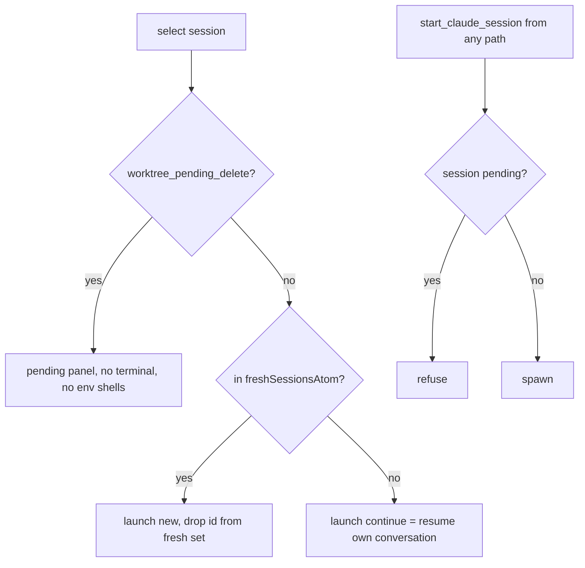

## Context

Walk findings on 2026-11-17 (installed `.deb` with `5efed37` + `a54f05f`):

- `delete_session` (`src-tauri/src/commands/workspaces_sessions.rs`) never calls `delete_branch`; only `delete_workspace` and `cleanup_merged_session` do, with `git branch -D` (`src-tauri/src/worktree.rs:257-270`). Every deleted worktree session leaves `nergal/<slug>` behind.
- After a failed reclaim the session is kept, but `git worktree remove --force` already deleted part of the worktree and its `.git` file. Opening the session launched Claude Code there; it asked for directory trust.
- That session started a fresh conversation although its transcript (`…test-reclaim-no-image-1794953161/831de48c….jsonl`) was intact. Cause: `freshSessionsAtom` (`src/stores/workspace.ts:162`) is set at creation (`worktreeGate.ts:87`, `linear.ts:570`, `clickup.ts:585`, `deepLinkRouter.ts:277`, `deepLinkRouter.ts:417`, `Sidebar.tsx:664`) and never cleared, so `Sidebar.tsx:614` skips the `continue` launch mode and `TerminalManager.tsx:45-52` picks `new` for every later launch of a session created in this run.

## Goals / Non-Goals

**Goals:** no orphan branch from a successful session delete without losing unshared commits; no agent launched in a half-deleted worktree; every relaunch resumes the session's own conversation.

**Non-Goals:**
- `delete_workspace` and `cleanup_merged_session` keep their `-D` semantics.
- A delete whose directory removal fails for a non-reclaim reason keeps the branch and only reports `worktree_left` (as today).
- Branches of sessions demoted at startup (`clear_session_worktree` sets `worktree_branch = NULL`, `src-tauri/src/db/sessions.rs`) stay orphaned; reconciling them is out of scope.
- Recovering conversations already overwritten.

## Decisions

### D1. Safe, atomic branch drop

One sequence, identical to `drop_session_branch`:

1. State: `git show-ref --verify --quiet refs/heads/<branch>`. Exit 1 → `Missing` (no notice). Exit 0 → `git rev-parse refs/heads/<branch>` gives the SHA; if that fails → `Kept`. Any other exit → `Kept` (could not check, iprev R3 #5).
2. In use → `Kept`: `git worktree list --porcelain` has a line exactly equal to `branch refs/heads/<branch>` (repo root and linked worktrees), or any worktree's git dir has `rebase-merge/head-name` or `rebase-apply/head-name` equal to `refs/heads/<branch>`, or `BISECT_START` equal to `<branch>` (a rebase or bisect lists the worktree as `detached`; `git branch -D` refuses these and `git update-ref -d` does not, iprev R2 #1, R3 #4, R4 #6). Any git failure here → `Kept`.
3. Safe check: `git rev-list <sha> --not --remotes <target> --` prints nothing and exits 0. `<target>` is `refs/heads/<merge_target>` when set, else `HEAD`. Non-empty output or a non-zero exit → `Kept`.
4. Write-ahead record: append `<RFC 3339 time>\t<repo path>\t<branch>\t<sha>` to `<data dir>/nergal/deleted-branches.log` (`dirs::data_dir()`; `create_dir_all` on the parent, then create + append, never truncated; the directory does not exist on a fresh install, iprev R5 #1). If the append fails or there is no data dir → `Kept` with a notice that says the restore record could not be written at that path (iprev R4 #1). A recorded line whose deletion later fails is harmless: it names a SHA that still exists.
5. Compare-and-delete: `git update-ref -d refs/heads/<branch> <sha>`; failure (the branch moved) → `Kept`. Success → `tracing::info!` and `Deleted { sha }`, which becomes a `branch_deleted` notice with `git branch <name> <sha>`.

- Alternative: `git branch -d`. Rejected: refuses squash-merged branches whose tip is on `origin`.
- Alternative: always `-D`. Rejected by the user.
- Alternative: check, then `git branch -D`. Rejected: not atomic (iprev R1 #7) and drops the branch reflog without recording the SHA.

**Rollback:** run the command from the "Branch deleted" toast, or take the SHA from `~/.local/share/nergal/deleted-branches.log` and run `git branch <name> <sha>`. Do it promptly: the runtime log (`~/.cache/nergal/nergal.log`) is truncated on every launch, and the next `git gc --auto` (triggered by commits, fetches or merges) may prune the now-unreferenced commits right away, because `gc.pruneExpire` is measured against object mtime, not against when the branch was deleted.

### D2. Typed delete notices

`delete_session` returns `Vec<CleanupNotice { kind: "worktree_left" | "branch_kept" | "branch_deleted", message }>` instead of `Vec<String>`. Toast mapping (`noticeToast`; `toastsAtom` types are `success | error | info`, `src/stores/toast.ts:8`): `worktree_left` → "Worktree left on disk"/error, `branch_kept` → "Branch kept"/info, `branch_deleted` → "Branch deleted"/info with the restore command. The decision after the directory removal lives in one pure step, `notices_after_removal`, so the data-loss ordering (branch only after a successful removal) is unit-tested (iprev R2 #3). A non-reclaim removal failure yields a `worktree_left` notice whose message also says the branch was kept (iprev R2 #10). Notices of deletes flushed by window close are dropped with the window; accepted. `delete_workspace` keeps `Vec<String>`.

### D3. Pending delete is derived from disk

`Session.worktree_pending_delete: bool`, `#[serde(default)]`, never persisted, computed in `get_workspaces` after the DB guard is released: `worktree_path` is set and it is not a working worktree, whether or not the directory still exists (iprev R2 #2). Not working = no `.git` entry, or a `.git` file whose `gitdir:` target (relative paths resolve against the worktree) is missing or lacks `HEAD`. Walk C3 (2026-11-18) showed why: a `git worktree remove --force` that fails on an unremovable file deletes `<repo>/.git/worktrees/<name>` but keeps the worktree's `.git` file (reproduced in a temp repo). The first rule (`.git` exists) missed it, the agent launched, and Claude Code asked for directory trust because the broken worktree no longer maps to its main repository. Pure filesystem checks, no git spawn, so the workspace load stays cheap. At the next startup a missing directory is demoted to the repo root by `session-resume-by-id`'s reconciliation; until then the session stays pending, so the agent never starts in a missing cwd. (The existing `Workspace.is_git` is computed under the guard in `db/workspaces.rs:69`; this change does not copy that.)

### D4. Pending sessions never get an agent

- Backend: `start_claude_session` (`src-tauri/src/pty.rs:665`) runs `refuse_launch` before `reserve_session_pty` (`pty.rs:685`), with its own row lookup (guard released before the disk check); a missing row is refused; a pending worktree is refused; a `cwd` that is given but is not an existing directory is refused; `cwd = None` keeps today's fallback. `spawn_aux_shell` (`pty.rs:1029`, quake/env shells) gains `State<SharedDb>` (no change for the JS caller) and refuses when its session's worktree is pending, even for a shell whose own cwd points elsewhere (accepted, iprev R2 #6, #7, R3 #7). This covers the sidebar, shortcuts, the resume modal, deep links, MCP-driven activation and the quake overlay.
- Frontend: `TerminalManager` renders a panel instead of `terminalService.show` and skips `spawnEnvShells` for a pending session. Copy: "This worktree was partly deleted. Press Delete to finish. If it fails again, run `sudo rm -rf <path>`, then press Delete." and a Delete button wired to the sidebar's delete flow. When a launch is refused anyway (stale flag), `terminalService` removes the container it added (declared before the `try` so the `catch` sees it; the input listeners live on the container's textarea and go with it) and shows at most one error toast per session key until a later `show` succeeds (iprev R3 #3). The same `catch` serves quake/aux shells, so their spawn failures now toast too; accepted (iprev R4 #5).

### D5. The fresh flag is consumed on first launch

`TerminalManager` calls `launchAndConsume(id, launchModes, fresh)`, which returns the mode and the next fresh set (the id removed only when the mode is `new`), and writes that set back (iprev R2 #9). `terminalService.show` deduplicates concurrent shows (`terminalService.ts:307`), so the atom update re-running the effect cannot spawn twice.

### D6. Resume follows `continued-in`

Walk 2026-11-18: Claude Code moved session "test" from `e3c759bf` (worktree project dir) to `18e18c76` (repo-root project dir). It wrote `{"type":"continued-in","continuedInSessionId":"18e18c76…"}` into the old transcript and fired no `SessionStart` hook, so Nergal kept `e3c759bf`. A later launch started fresh (`b2be2d83`, no prompt sent, no transcript) and overwrote the stored id. `pick_resume_id` now follows `continued-in` from the stored id: it reads only the tail (64 KiB) of each transcript, because the record is appended when the old file stops growing. It follows up to 10 hops with a visited set and keeps the last id whose transcript exists. Why Claude Code started fresh at 03:02:41 was not reproduced (`claude -p --resume` across directories keeps the id); following the continuation removes the dependency on it.

## Risks / Trade-offs

- [User removes the folder by hand and restarts before pressing Delete] → startup reconciliation demotes the session to the repo root and clears `worktree_branch`; that branch never goes through the safety check and stays. The panel copy asks to press Delete after the manual step to avoid this. Accepted.

- [Stale remote-tracking ref] → a branch deleted on the remote without merging but still present as `origin/nergal/x` locally reads as safe; the local branch is deleted and a later `fetch --prune` drops the last ref. Mitigation: the write-ahead record in `deleted-branches.log` and the "Branch deleted" toast both carry `git branch <name> <sha>` (the runtime log is truncated on launch and does not help); accepted.
- [Remote-tracking refs not fetched yet] → a branch pushed from elsewhere reads as not safe and is kept. Safe direction.
- [Kept branch reused by a new session] → `create_worktree` reuses an existing `nergal/<slug>` branch and directory (`worktree.rs:352-354`, `:368-378`). Slugs carry a timestamp, so a collision needs the same name in the same second. Accepted.
- [Branch dropped before the final row delete] → if the final DB delete fails, the row survives without its branch. Accepted: the session can still be deleted again.
- [A gutted directory that still has `.git`] → not marked pending; behaves as today. Acceptable: git removes `.git` early in a failed `worktree remove`.
