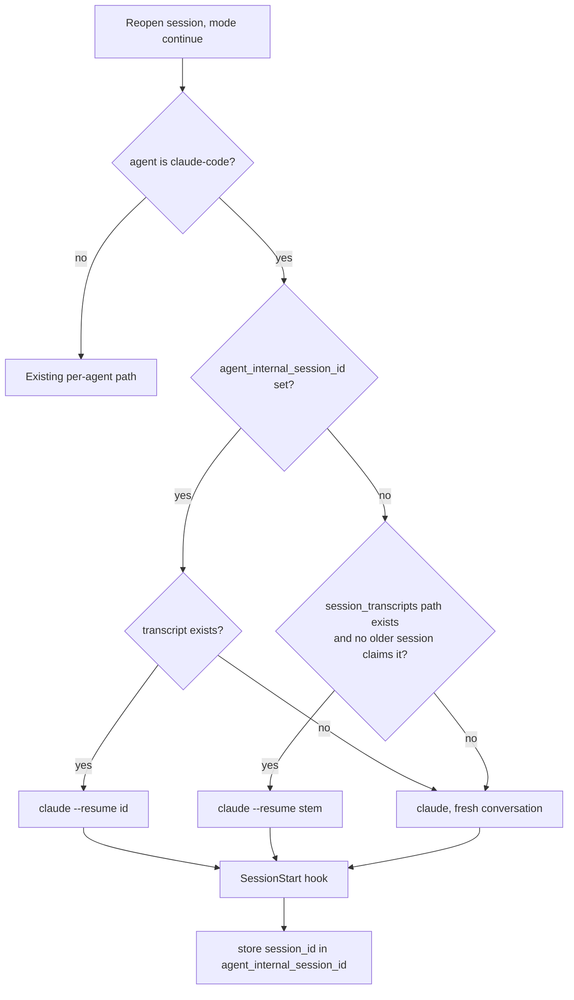

## Context

Claude Code sessions reopen through `start_claude_session` (`src-tauri/src/pty.rs`). For the `continue` intent it reads `sessions.agent_internal_session_id` and falls back to the `continue` sentinel, which the CC adapter turns into `claude --continue`. The CC adapter never fills that column, so every CC session uses `--continue`. `--continue` picks the newest conversation of the cwd.

Two situations put two sessions on one cwd:

- Several repo-root sessions in one workspace (non-git subfolders, or sessions demoted from a worktree).
- `reconcile_worktrees` (`src-tauri/src/lib.rs`) demotes a session whose worktree directory is gone to a repo-root session.

Evidence from XD001 (2026-11-14): "Upgrades de packages" now records the main session's transcript (`-home-felipe-Projects-XD001/f3d85e80…`), while its own transcript (`…upgrades-de-packages-1792961692/8278600b…`) is still on disk.

The sidebar gates delete on `worktree_path !== null`, so every demoted session is undeletable.

Verified on 2026-11-17 with Claude Code: `claude --resume <id>` launched from a different directory restores the conversation and keeps appending to the original transcript file.

## Goals / Non-Goals

**Goals:**

- Each session reopens its own conversation, whatever its cwd.
- A lost worktree keeps the session and its conversation; the user sees a notice.
- Demoted and extra repo-root sessions can be deleted; the workspace always keeps one repo-root session.

**Non-Goals:**

- Recreating lost worktree directories. The user deletes worktrees on purpose once the work is committed.
- Changing how Pi, OpenCode or Codex resume (frozen agents).
- Repairing the XD001 rows. That is a one-off data repair, run outside this change and recorded in `handoff/evidence.md`.

## Decisions

### D1. Capture the conversation id from the top-level `SessionStart` only

`SessionStart` carries Claude Code's `session_id`, and the hook envelope carries `nergal_session_id`. The hook server writes the id to `sessions.agent_internal_session_id` for Claude Code sessions.

- Alternative: parse the newest transcript of the cwd at spawn time. Rejected: this is the same "newest in cwd" guess that causes the bug.
- Alternative: launch with `claude --session-id <uuid>` chosen by Nergal. Rejected: `/clear` and `/resume` inside Claude Code switch conversations, and only the hook sees the new id.
- Alternative: also capture on `Stop`. Rejected (iprev R1 #8): installing the fix restarts the app, so every session relaunches through `SessionStart`; `Stop` only widens the nested-process surface.

### D5. Ignore nested agent processes (iprev R1 #1)

`NERGAL_SESSION_ID` lives in the PTY shell env (`src-tauri/src/pty.rs:457-459`), so every `claude` started inside the session inherits it: a skill's `claude -p`, a plan evaluator, a user typing `claude`. Their hooks report the parent's `nergal_session_id` with their own `session_id`. Without a filter they overwrite the stored id and the `Stop` transcript marker, which recreates the bug.

The hook CLI is alive while it sends, so it walks its own ancestors (at most 16, refreshing only the pids on the chain with `sysinfo`) and sends `agent_chain = [{pid, claude}]`. The server finds the session's PTY shell pid (`PtyInstance.child_pid`) in the chain and counts the runs of consecutive `claude` entries below it. One run is the session's own agent, including wrappers (`bash` script, `direnv exec`) and launchers (`npx` → `node`, both flagged, one run). Two or more runs mean a `claude` started inside the agent's tool shell: nested (iprev R2 #1). The top-level agent was verified as a child of the terminal shell (2026-11-17: `claude` 9132 → `zsh` 8473).

- A complete chain (it reached pid 1) without the shell pid → nested: the process does not descend from the session's PTY, e.g. a `tmux` pane, `setsid`, `nohup` after the parent exited (iprev R3 #1). No chain, a malformed chain, a truncated chain, or an unknown shell pid → top-level with a `warn` log, so an unusual setup never loses resume. Inverse risk: a PTY shell in another pid namespace would always look detached; distrobox and toolbox share the host pid namespace. The nested risk stays only where detection fails.
- Alternative: compare the parent of the nearest `claude` with the shell pid. Rejected (iprev R2 #1): any non-`exec` wrapper would mark every event nested and the session would never resume.
- Alternative: the server walks `/proc` from the hook pid. Rejected: `nergal hook send` exits right after writing, so the pid is often gone when the server reads it.
- Alternative: an env marker. Rejected: env is inherited by nested processes, and Claude Code sets `CLAUDECODE`/`CLAUDE_CODE_SESSION_ID` for all its children, including hooks.
- The same filter guards every session-identity write of `Stop`: the transcript marker, background tasks and the last assistant message (`src-tauri/src/hooks/server.rs:817-842`), which nested processes contaminate today (iprev R2 #3).

### D2. Resolve the id at spawn, never `--continue`

Order: stored id → (only when no id is stored) last `Stop` transcript stem → fresh start. Each candidate must exist on disk as `<projects>/<dir>/<id>.jsonl`. A stored id without a transcript (Claude Code writes the file lazily, e.g. right after `/clear`) means a fresh start, never the older transcript the user cleared (iprev R1 #2).

The lookup splits into `resume_candidates` (reads rows under the DB lock) and `pick_resume_id` (filesystem checks without the lock), per `db-lock-discipline` (iprev R1 #5). The projects directories are `$CLAUDE_CONFIG_DIR/projects` (or `~/.claude/projects`) plus the grandparent of the stored transcript path, because the GUI env may lack a `CLAUDE_CONFIG_DIR` that only the user's shell rc sets (iprev R1 #6).

- Existence check: `claude --resume <unknown id>` exits with "No conversation found" and leaves the user at a bare shell. A fresh start is the better failure.
- The transcript fallback covers rows written before this change. When two legacy sessions share one transcript (both used `--continue` on one cwd), the oldest session of the workspace keeps it. The first session of a workspace is its original repo-root session, so the main conversation stays with the main session.
- A legacy demoted session can hold a stale marker that points at an older main conversation no other row references any more (iprev R2 #2). So a legacy transcript in the repo root's project directory resumes only for the oldest session of the workspace. Worktree transcripts live in their own project directories and are unaffected. Trade-off: a second repo-root session of a non-git workspace starts fresh once after the upgrade; from then on `SessionStart` records its own id.
- Alternative: keep `--continue` as the last fallback. Rejected: it is the bug.
- Alternative: a migration that backfills the column. Rejected: the read-time fallback needs no migration, and `SessionStart` rewrites the column on the first launch.

### D3. Demote, keep the conversation, notify

`reconcile_worktrees` keeps demoting (clearing `worktree_path` and `worktree_branch`), because the user chose "repo root + own conversation". It returns the names of the sessions it really demoted (a failed update is not listed). The names live in managed state until the frontend takes them with `take_reconciled_worktrees` after `setupHookListeners` mounts; the command empties the list. A timed emit could fire before the listener exists (iprev R1 #9).

- Alternative: keep the link and block the launch behind an orphan panel. Rejected by the user: the worktrees were deleted on purpose.
- Alternative: recreate the worktree from its branch. Rejected: branches are often deleted too (the "Upgrades" branch was).

### D4. Delete guard: never the last repo-root session

The backend guard lives in both commands that delete session rows. `cleanup_merged_session` (merged-PR cleanup, which can target a repo-root session checked out on the PR branch) refuses before archiving plans or touching git (iprev R3 #2). `delete_session` has an early check before `stop_event_pump`, repeated under the lock that deletes the row, so two concurrent deletes cannot remove both of the last two repo-root sessions (iprev R1 #4). The sidebar computes the same predicate from `workspacesAtom`: `worktree_path !== null || rootCount(workspace) > 1`. During the delete grace window the atom hides the pending row, so the sidebar is stricter than the backend, never looser (iprev R2 #5). A backend refusal only comes from a real race between two deletes; it reloads the workspaces and shows an error toast (iprev R1 #3). The terminal was already destroyed by then; it relaunches in `continue` mode when the user selects the session, which now resumes the right conversation. Today `finalize` in `src/stores/pendingDeletes.ts:130-140` swallows the error after destroying the terminal.

- Session creation reads `session_count_for_workspace == 0` to create a repo-root session. Keeping one repo-root session therefore keeps every new session on a worktree.
- Alternative: an explicit `is_main` column. Rejected: it needs a migration, and the predicate above already expresses the rule.
- Alternative: allow every delete. Rejected by the user.

## Risks / Trade-offs

- A delete that passes the early check and loses the race at the final check has already stopped the event pump and run `claim_finalization` with its footer/MOC writes (`src-tauri/src/commands/workspaces_sessions.rs:450-509`). Accepted: the sidebar never offers that delete, so only two concurrent deletes of the last two repo-root sessions reach it (iprev R3 #3).
- Contiguous `claude` runs merge, so a `claude` started directly by another `claude` with no shell between them would read as one agent. The walk records a `pstree -p` with subagents and background tasks running to confirm Claude Code does not do this today (iprev R3 #4).

- Claude Code changes the hook payload or the transcript layout → the existence check fails and sessions start fresh. Mitigation: the fresh start is safe, and the projects directory honors `CLAUDE_CONFIG_DIR`.
- A legacy repo-root session whose only transcript was the main one starts fresh. This is correct: that conversation was never its own.
- A user runs `/resume` inside Claude Code to switch to another session's conversation. `SessionStart` records it, and both sessions now point at one conversation. This is accepted: the user did it on purpose.
- The demoted session's later turns stay in the old worktree's transcript file. Summaries and the session directory read `transcript_path`, so they keep working.
