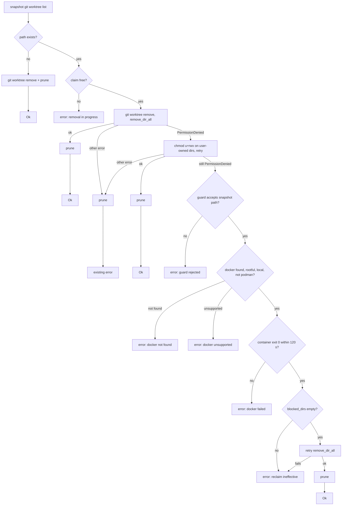

## Context

`remove_worktree` (`src-tauri/src/worktree.rs:389`) runs `git worktree remove --force`; on failure it calls `std::fs::remove_dir_all`, then `git worktree prune`, then bails. On `PermissionDenied` the error carries a `sudo rm -rf <path>` remedy (BUG-42, test `remove_worktree_permission_error_names_path_and_remedy`). XD001 dev containers run as the host user since `73f5cbab` (2026-11-11), but older worktrees and ad-hoc `docker run` calls by agents still leave root-owned build caches.

## Goals / Non-Goals

**Goals:** delete such worktrees from Nergal without a terminal; keep the privileged step narrow and never add privilege the user lacks.

**Non-Goals:** fixing container configuration in user projects; `pkexec`/polkit (dropped, see D2); macOS/Windows (frozen); reclaiming during automatic rollbacks.

## Decisions

### D1. Unblock directories, then reuse the normal deletion

Deleting an entry needs write and search permission on its parent directory, not ownership of the entry. So the fix only touches directories: first unprivileged (`chmod u+rwx` on the user's own directories, which covers read-only trees such as Go's module cache), then, when directories owned by another user remain, the Docker step re-owns every directory and adds `u+rwx`. The deletion stays in the unprivileged `remove_dir_all`. A guard bug can then misassign a directory's owner or mode, never delete data, and regular files, hardlinks and device nodes never change owner (iprev R3 #1, which also closes R1 #10).

- Alternative: `rm -rf` inside the container. Rejected: the privileged step would delete.
- Alternative: re-own every entry (`chown -R`). Rejected: ownership alone does not make a `0555` directory deletable, and it would hand the user hardlinked inodes and device nodes.

### D2. Docker only

Root-owned files in a worktree come from containers, so Docker is present when the problem exists (user, 2026-11-17). The user is in the `docker` group, which is root-equivalent, so the container adds no privilege.

- Alternative: `pkexec chown` as fallback. Rejected (iprev R1 #2): every path component above the worktree is user-owned, so a same-user process (an agent) can swap one for a symlink between the guard and the root `chown`, which escalates the user to root. A safe helper with `openat(O_NOFOLLOW)` was offered and declined in favor of Docker only.
- Rootless Docker or Podman-as-`docker` is skipped (iprev R1 #4): container root maps to the user, so `chown` would move the user's own files to a subordinate uid and make them harder to delete. Podman is detected first: `docker --version` mentions `podman` → `docker unsupported` (iprev R3 #5). Detection: `docker info --format '{{json .SecurityOptions}}'` must succeed and must mention neither `rootless` nor `userns` (a rootful daemon with `userns-remap` maps container root to a subuid too, iprev R2 #3). `docker context inspect --format '{{.Endpoints.docker.Host}}'` must start with `unix://`: a remote daemon would resolve the bind path on another machine.

### D3. Container hardening

`docker run --rm --name nergal-reclaim-<pid>-<n> --pull never --network none --user 0:0 --entrypoint find --mount type=bind,source=<canonical>,target=/w alpine:3 /w -xdev -type d -exec chown <uid>:<gid> {} + -exec chmod u+rwx {} +`

Smoke-tested on this host 2026-11-17 with busybox `find` in `alpine:3` (both the first vector and this hardened one): two root-owned `0555` directories became user-owned `755`, the root-owned file inside stayed root-owned, and the user then deleted the tree (iprev R3 #7).

- `--entrypoint find` and `--user 0:0` (iprev R4 #7): the vector does not depend on the `ENTRYPOINT`/`USER` of whatever is tagged `alpine:3` locally; a replaced tag fails with a clear error instead of running another command.
- `-xdev` (iprev R4 #7): Docker bind mounts are recursive, so a host filesystem mounted below the worktree would be re-owned too; `-xdev` keeps the step on the worktree's filesystem.

- `--mount` instead of `-v` (iprev R2 #2): `-v` creates a missing source as root, which would leave a root-owned empty directory if the worktree vanished after the guard. `--mount` fails instead. Its value is CSV, so the guard rejects `,`, `"`, `:` and newline (iprev R3 #8).
- `--pull never` (iprev R1 #6): no network pull of a mutable tag with root on the mount; a missing image is a reclaim failure with a clear reason.
- `find` without `-L` and `-type d`: symlinks are never followed nor matched, so the step touches only real directories. A symlink swapped during a race resolves inside the container's root filesystem, not the host's.
- Timeout 120 s (spawn + poll `try_wait`): on expiry `docker rm -f <name>` stops the container itself, with its own 15 s limit, then the CLI is killed and reaped whatever `rm -f` did (iprev R2 #6, R4 #2). Killing only the CLI would leave the `--rm` container chowning as root; an unbounded `rm -f` on a hung daemon would keep the removal claim forever.
- stderr is drained to EOF by a reader thread that keeps only the first 4 KB for the `warn!` log (iprev R2 #7, R4 #3). Stopping early would fill the pipe and turn a noisy run into a false timeout.
- Success requires exit 0 and no directory of the tree left without `w`+`x` for the process, or unreadable (`blocked_dirs`, via `access(2)`; a `read_dir` that fails with `EACCES` counts as blocked) (iprev R2 #4, R3 #3). Docker Desktop's virtiofs can exit 0 without effect; that case reports `reclaim ineffective`.

### D4. Strict guard before prune

Exact depth `.worktrees/nergal/<slug>`, real directories via `symlink_metadata` at each level, worktree owned by `getuid()`, no `,`/`"`/`:`/newline (`--mount` CSV), and listed in a `git worktree list --porcelain` snapshot taken before `git worktree remove` (iprev R1 #3, R2 #1). The snapshot is required because `git worktree remove --force` drops `.git/worktrees/<id>` even when it fails halfway (verified by the reviewer with git 2.34.1).

### D7. One removal per path

A process-wide `Mutex<HashSet<PathBuf>>` holds the canonical paths under removal; a second removal of the same path returns `removal in progress` (iprev R2 #5). Moving the commands off the main thread (D6) removed their implicit serialization, so this guard replaces it. A path that does not exist takes no claim and keeps today's prune-and-`Ok` behavior (iprev R3 #2). `claim_removal` canonicalizes inside the claim and returns `ClaimError::Gone` when the path vanished between the existence check and the claim, which follows the same prune-and-`Ok` branch instead of a false `removal in progress` (iprev R4 #4). Commands are argument vectors, never `sh -c`.

### D5. Reclaim only for user-initiated deletes

`remove_worktree` keeps its signature and never reclaims. A new `remove_worktree_reclaiming(repo, wt, &DockerReclaimer)` is used by `delete_session`, `delete_workspace` and `cleanup_merged_session`; `DockerReclaimer` exists on every target (its Docker step reports `docker unsupported` off Linux), so `delete_workspace` shares one instance and checks Docker once (iprev R3 #6). MCP, Linear and ClickUp rollbacks keep `remove_worktree` (iprev R1 #11).

### D6. Off the UI thread

`delete_workspace` and `cleanup_merged_session` are sync commands, which Tauri runs on the main thread; `delete_session` is async but calls the removal inline. All three move the removal into `tauri::async_runtime::spawn_blocking` (iprev R1 #1). The two sync commands become `async`.

Every error branch runs `git worktree prune`, releases the claim, and carries the path, the real `io::Error` of the last attempt, and the manual remedy. For `reclaim ineffective` the remedy also says to stop containers that mount the worktree.

### D8. Linux only, gated

Every new helper and the `Some` branch of `remove_worktree_with` are `#[cfg(target_os = "linux")]` (they use `libc::access`, `MetadataExt::uid` and unix modes; `libc` is a `cfg(unix)` dependency, and the `windows-check` CI gate rejects ungated unix seams). `DockerReclaimer::new()` exists on every target so `delete_workspace` keeps one call site; off Linux, `remove_worktree_reclaiming` delegates to `remove_worktree`, so macOS and Windows keep today's behavior exactly (focus freeze 2026-10-04, iprev R4 #1). The tests of groups 1–2 are Linux-gated.

## Risks / Trade-offs

- [No Docker or rootless Docker] → the user keeps the manual remedy, now with the reason.
- [`alpine:3` missing locally] → `docker failed`; the user pulls it once. Accepted to avoid a silent network pull with root on the mount.
- [Guard-to-mount race by a same-user process] → Docker resolves the bind path as root, but the user's `docker` group already grants root, so no new privilege. Accepted.
- [Large trees make `chown` slow] → bounded by the 120 s timeout, off the UI thread.
- [A container still running with the worktree mounted (e.g. a dev stack left up)] → it can recreate root-owned files during the retry; the result is `reclaim ineffective` with a remedy to stop those containers. Not detected (iprev R4 #5).
- [`create_worktree` reuses an existing directory with the same slug] → slugs carry a timestamp (`derive_worktree_slug`), so a reuse during a reclaim needs the same name in the same second. Accepted.

## Revision 1: retry path and inode pin (code review, 2026-11-17)

The code review (`handoff/REVIEW.md`) found two Important issues.

**Escalation through a sandboxed agent (security).** D2 assumed every same-user process already reaches the Docker socket. A Claude Code agent running under its sandbox does not, yet it can write inside `<repo>/.worktrees/nergal/*` from the repo-root session. It can force the Docker branch and swap the worktree for a symlink to `/etc` between the guard and `docker run`. Docker then mounts `/etc` and re-owns it. Fix: the guard returns the worktree's `dev:ino`, and the container runs a literal script that checks `stat -c %d:%i /w` against it before acting. A bind mount pins the inode, so the race is closed. Verified on this host (ext4): host and container report the same `dev:ino` through the bind. Vector: `--entrypoint sh ... alpine:3 -c '<literal script>' reclaim <dev:ino> <uid:gid>`; values travel as positional arguments, never interpolated into the script, and nothing runs through a host shell.

**One-shot reclaim (design).** `git worktree remove --force` drops the registration on the first attempt, and the commands deleted the row even when cleanup failed, so a failed reclaim left an orphan with no retry. User decision (2026-11-17): keep the session. A reclaim-path failure now keeps the row and the branch and returns the error; `delete_workspace` keeps the workspace and the failed sessions. On retry the guard accepts the worktree path Nergal recorded for that session (the registration is gone by then). Removal errors outside the reclaim path keep today's behavior.

Smaller fixes from the same review: `chown -h` in the container; `unblock_own_dirs` sets `(mode & 0o1755) | 0o700`, so a swapped symlink can never receive group or other write bits; `docker run` and `docker rm -f` pass `-H <endpoint>` from the probe; the docker child runs in its own process group, the whole group is killed on timeout, and the stderr reader join has a 5 s limit; `reclaim ineffective` always carries the manual remedy; the `InProgress` branch does not prune (the other removal does); off Linux `DockerReclaimer` is an empty struct without `Reclaimer`.

- Accepted residue: after a failed reclaim the kept worktree may have lost group/other write and setgid bits on the user's own directories, because `unblock_own_dirs` runs before the container and applies `(mode & 0o1755) | 0o700`.
