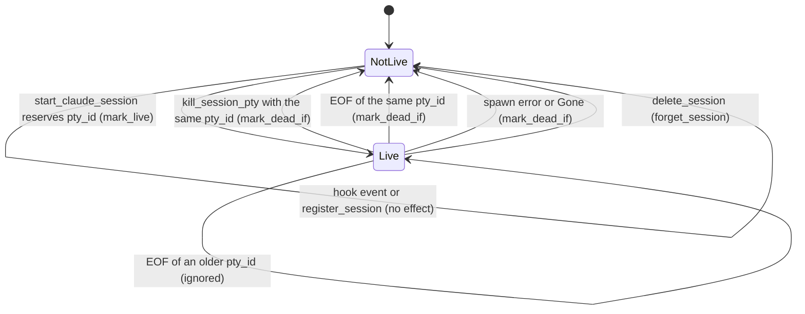

## Context

`AgentRuntimeState::agent_id_cache` has two jobs today. It resolves which adapter owns a session, and `live_session_ids()` reads it as the liveness source for the MCP tools. Many paths register a session: creation, resume approval, the spawn fallback, and the hook server for any uncached session. Only `delete_session` removes one. So a session stays "live" after its tab closes or its PTY exits, until Nergal restarts. See `proposal.md` and the `session-directory` delta spec.

The PTY layer already has an exact record of agent PTYs: `PtyManager.session_ptys` maps each session id to its current `pty_id`, reserved before spawn and removed on kill. The MCP daemon cannot reach `PtyManager`: `DaemonContext` holds `AgentRuntimeState`, the DB and a `SessionDelivery` bridge.

## Goals / Non-Goals

**Goals:**
- Liveness becomes true when the agent PTY starts and false when it is killed or exits.
- A late hook event or a late exit of an older PTY cannot change liveness the wrong way.
- Every MCP liveness check reads one source.

**Non-Goals:**
- Detecting that the agent process exited back to the shell inside a still-open tab. The PTY is alive, so the session stays live.
- Changing what the frontend does when an agent PTY exits on its own.
- Changing adapter resolution. `agent_id_cache` keeps its role and its writers.

## Decisions

### D1. A separate live set in `AgentRuntimeState`, keyed by session id with the PTY id as value

`AgentRuntimeState` gains `live_ptys: Arc<DashMap<String, String>>` (session id → pty id). Methods: `mark_live(session, pty_id)`, `mark_dead(session)`, `mark_dead_if(session, pty_id)`. `live_session_ids()` reads `live_ptys`. `forget_session` also removes the entry. `register_session` does not touch it.

The PTY id acts as a generation token. Only the PTY that owns the entry can clear it on exit.

Alternatives:
- **Call `forget_session` on kill and on exit.** Rejected. The hook server re-registers any uncached session on its next event (`hooks/server.rs:958-967`), so a `SessionEnd` that arrives after the kill would make it live again. It would also drop adapter resolution, which the spawn path then rebuilds from the DB.
- **Query `PtyManager` from the daemon through `SessionDelivery` / `AppHandle`.** Rejected. Liveness checks would need a live Tauri app, so the daemon tools lose their unit tests (`NoopDelivery`). It also mixes the delivery bridge with session state.
- **A plain `DashSet` without the PTY id.** Rejected. A late end-of-file from a killed PTY would clear a session that was already spawned again.

### D2. Liveness changes under the `session_ptys` lock

Every live-set write that goes with a reservation change (reserve, release, kill) happens while the same `session_ptys` lock hold changes the reservation. The PTY exit (`mark_dead_if` on its own id) and the session delete (`forget_session`) change only the live set and need no reservation lock. This gives both maps one total order, so a concurrent kill and start cannot interleave between them.

- `reserve_session_pty` takes `&AgentRuntimeState`. On a new reservation it calls `mark_live(session, pty_id)` and `record_activity(session, "running", None)` inside its lock hold. The existing-reservation early return changes nothing. The `running` mode makes deliveries queue until the agent's first `Stop`, so a note never lands in a shell that has no agent yet (iprev R2#4). If the agent never reaches a `Stop`, notes stay queued, which is safer than pasting into the shell.
- `release_session_pty` takes `&AgentRuntimeState` and the pty id. It removes the reservation only when it still maps to that pty id (compare-and-remove), and calls `mark_dead_if(session, pty_id)` in the same lock hold. A late release of an older failed spawn cannot remove a newer reservation (iprev R2#2). `start_claude_session` already calls it on the `spawn_pty` error.
- On `ReservationOutcome::Gone` the kill path already removed the reservation and cleared liveness for that pty id (D3). `start_claude_session` adds `mark_dead_if(session, pty_id)` there as a no-op safety net.

Marking at reservation orders the mark before any end-of-file of the same PTY. Marking after `Intact` would let a shell that dies at once clear nothing and then stay live forever.

Alternatives:
- Mark after `ReservationOutcome::Intact`. Rejected for the ordering reason above.
- Mark outside the lock, right after `reserve_session_pty` returns. Rejected by iprev R1: a kill between the two steps could clear a newer PTY, or an older `mark_live` could overwrite a newer one.

### D3. Kill and exit paths

- `kill_session_pty` calls `mark_dead_if(session, removed_pty_id)` with the id it removes from `session_ptys`, inside that lock hold. A start that reserved a newer PTY right after keeps its liveness. If `kill_session_aux_shells` fails first, the command returns before touching the agent PTY, and the session correctly stays live.
- The agent branch of the reader thread in `spawn_pty` calls `mark_dead_if(session, pty_id)` with its own `pty_id`. It reaches `AgentRuntimeState` through `eof_app.try_state`, like the existing `SharedDb` lookup. It does not need the `session_ptys` lock: the compare-and-remove on its own id cannot clear a newer PTY. It leaves the `session_ptys` reservation in place, as today (see D5).
- `delete_session` already calls `forget_session`, which now clears the entry too.
- `shutdown_all` clears `session_ptys` on app exit. The live set dies with the process, so it needs no change.

### D4. Consumers keep their call sites

`directory.rs`, `messaging.rs` and `worktree_sessions.rs` keep calling `live_session_ids()`. Only its source changes. Test helpers that faked liveness with `register_session` switch to `mark_live`.

`descriptor_from` (`mcp/directory.rs`) splits the runtime activity of a not-live session in two (user decision 2026-11-23, after the walk). Fields that claim something about the present (`mode`, `waiting_for`, `background_tasks`, `session_crons`) come from the persisted row or stay empty, because the agent is gone. Fields that describe the past (`last_activity`, `last_assistant_message`, `recently_touched_files`) keep their last recorded value, falling back to the persisted row when the daemon never saw the session. A first version blanked every runtime field, and the walk showed `last_activity` going back to the creation time and the last message turning null.

### D6. MCP caller identity reads the live set

`resolve_session_hint` resolved a caller's `NERGAL_SESSION_ID` against `agent_id_cache`, and the CC side map without any check. The `nergal-mcp-server` spec requires the live session registry. After this change it resolves a nergal id only when it is in `live_ptys`, and a CC id only when the nergal id it maps to is in `live_ptys` (adversarial review). A caller always runs inside its own agent PTY, which is reserved before the agent starts, so a real caller is always live.

Alternative: keep the cache for identity. Rejected: two definitions of "live", and a killed session's id would keep acting as a sender.

### D5. Resume approval refuses a session whose tab is still open

An agent PTY that exits on its own becomes not live, but its `session_ptys` reservation stays. The frontend keeps the dead terminal, and `start_claude_session` returns the existing id early. So an approved resume would spawn nothing and its queued prompt would never land.

`approve_worktree_request` already holds `State<PtyManager>`. For a resume request it reads both inputs in one `session_ptys` lock hold through `PtyManager::resume_block_state(&agents, session) -> (is_live, has_pty)`, the same total order as D2 (iprev R3#4), then calls a pure `resume_blocked_reason(is_live, has_pty)` before `resume_session`. A live target returns the existing "session became live before approval — message it directly" reason, checked first (iprev R2#1). A not-live target with a reservation (`PtyManager::has_session_pty`) returns "the session's tab is still open; close it, then request the resume again". Either reason resolves the request as `failed` and queues no prompt. `resume_session` keeps its own liveness re-check.

Alternatives:
- Release the reservation on end-of-file and have the frontend respawn on activation. Rejected for this change: the frontend reuses the dead terminal entry, so this needs a frontend respawn path. That is a larger change with its own walk.
- Leave the session live after a self-exit. Rejected: it reports a dead agent as live, which is the bug being fixed.

## State machine

## Risks / Trade-offs

- [An agent that exited to the shell in an open tab reads as live. `send_to_session` then pastes the note into the user's shell and submits it, so the shell runs it as a command] → Out of scope by user decision and unchanged from today. The note is sanitized but still runs as shell input. Track separately if it shows up.
- [A `start_claude_session` error after `Intact` (adapter lookup, `adapter.spawn`, writing the launch command) leaves a bare shell PTY with its reservation] → Unchanged from today. The session stays live because its PTY exists, the same state as an agent that exited to the shell. Closing the tab kills it and clears liveness.
- [Between a resume or create approval and the frontend reservation, the session reads not live. A `send_to_session` in that window returns `inactive_target` instead of queuing] → The window is short: the frontend activates the session and reserves its PTY right after the approve call returns, before the 5 s shell wait. The requester learns of the approval through a PTY note and needs a full model turn before it can send. Once reserved, the session is live and `record_activity("running")` from the approval makes delivery queue until the first idle, as the comment at `worktree_sessions.rs:1014-1017` intends. That comment is updated to say so.
- [Between approval and spawn, a second resume request for the same session can be queued] → The approval re-checks liveness (`worktree_sessions.rs:1000-1008`) and refuses it once the first has spawned.
- [A session killed before its first `Stop` has no transcript marker, so it leaves `list_sessions` and `get_session` answers not found] → Correct under the existing visibility requirement. Agents that kept its id can still call `request_session_resume`, which does not need the marker. Declared in the proposal.
- [`resume_session` still records `running`, which the reservation now also does] → Redundant and harmless. Kept, so a resume approval keeps its own warmup guarantee if the reservation path changes later.
- [Inside the 5 s soft-close window the session stays live] → Intended. The PTY still exists and an undo restores it.
- [A new spawn path that forgets `mark_live`] → Only `start_claude_session` spawns agent PTYs today. Aux and quake shells use `spawn_aux_shell` and are not sessions.

## Migration Plan

In-memory state only. No schema or config change. Rollback is a revert of the commit.

## Open Questions

None.
