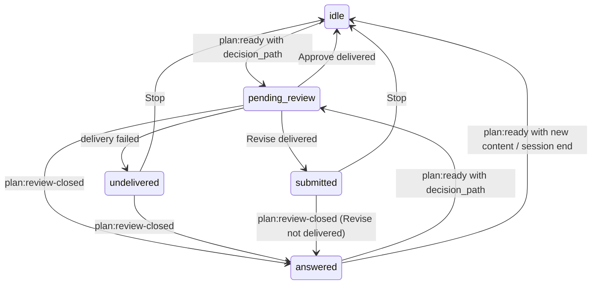

## Context

A plan review is a round trip. `nergal hook plan-review` (`src-tauri/src/hooks/cli.rs:206`) creates a FIFO, sends a `PlanReview` event and blocks on the FIFO for up to 30 minutes. The GUI shows the plan, and Approve or Revise writes a JSON decision into the FIFO through `submit_plan_decision` (`src-tauri/src/commands/plans.rs:114-147`).

The panel learns of the review from `plan:ready`. Two handlers emit it: `PreToolUse[ExitPlanMode]` (`src-tauri/src/hooks/server.rs:1099-1135`) without `decision_path`, and `PlanReview` (`server.rs:1237-1285`) with it. The listener (`src/stores/hooks.ts:276-300`) overwrites the plan state and sets `pending_review` for both. The `PreToolUse` hook is installed with `async: true` in `~/.claude/settings.json`, while `PermissionRequest[ExitPlanMode]` is synchronous, and the socket server spawns a task per connection (`server.rs:370`). So the preview can arrive after the review and wipe its decision path.

Three silent failures follow:
- The review state without a decision path: `handleApprove` (`src/components/plan/PlanPanel.tsx:115-127`) resets the state to `idle` and sends nothing. `handleRevise` (`:98-113`) returns without feedback.
- A stale decision path: `std::fs::write` creates a regular file when the FIFO is gone and reports success. With a FIFO that has no reader, the open blocks, on the main thread, because the command is synchronous (`commands/plans.rs:113-114`).
- The command trusts any path the webview sends.

## Goals / Non-Goals

**Goals:**
- A decision from the panel reaches the waiting hook, or the user sees that it did not.
- The panel shows Approve and Revise only for a review that has a decision path.

**Non-Goals:**
- Dropping `decision_path` from the command contract.
- An empty plan path from `resolve_active_plan` (inline plan with no file): kept as today.
- The frozen Windows pipe path and the Codex, OpenCode and Pi adapters.
- Telling the panel when the hook times out or CC's own prompt answers first.

## Decisions

### D1. Only `PlanReview` opens a review; content ties a preview to its cycle
One pure helper computes the next plan state and review state from the previous ones and the payload, and the listener applies it to the session entry and to the document entry for the payload's path. A payload with `decision_path` opens the review. A payload without one whose content equals the stored `original` (the text last received, never the user's edits) belongs to the same cycle (the late async preview): it keeps decision path, session id, state, and the stored `content` and `mode`, so an edit made before the preview arrives survives. A payload without one and with new content starts a new cycle: decision path empty, state `idle`, so a dead FIFO from an earlier cycle never keeps the buttons.
- Alternative: correlate by `tool_use_id`. Rejected: the `PermissionRequest` input has no tool use id to match against.
- Alternative: stop emitting `plan:ready` from `PreToolUse`, or drop a payload without `decision_path`. Rejected: the preview opens the plan tab early, and a setup without the `PermissionRequest` hook still shows the plan.
- Alternative (dropped after iprev round 1): when `PlanReview` resolves no plan, reuse the session's current plan. Rejected: `resolve_active_plan` returns `None` only when neither an inline plan nor a file exists, and then the current plan is from an earlier cycle, so the user would approve the wrong text.

### D2. Write only to the registered, live FIFO, off the main thread
`submit_plan_decision` becomes `async` and runs the write in `spawn_blocking`. Before any open, it claims the session's entry in `pending_plan_fifos` (`src-tauri/src/agents/claude_code/adapter.rs:74`, registered by `PlanReview` at `server.rs:1247-1251` under the same Nergal session id the panel sends) with a conditional remove (`DashMap::remove_if`, path equal to the requested one). Only the claimer writes, so two submits for one review never put two JSON values in the pipe; the hook reader cannot recover from that (`hooks/cli.rs:411` treats `POLLHUP` without data as a tick and waits 30 minutes). A mismatch claims nothing and keeps the entry. The claim is never undone: every write error means the hook can no longer take a decision. A shared Unix helper opens with `O_WRONLY | O_NONBLOCK | O_NOFOLLOW | O_CLOEXEC` and no `O_CREAT`, requires `fstat` to report a FIFO, and writes with `poll(POLLOUT)` until the payload is out or the deadline (5 s) passes. `ENXIO` (no reader yet) is retried within the deadline, because the hook opens its FIFO a moment after it sends `PlanReview` (`hooks/cli.rs:259-283`); `ENOENT`, `ELOOP`, `EPIPE`, a non-FIFO, and `ENXIO` at the deadline are errors. The adapter's own `submit_plan_decision` calls the helper inside `spawn_blocking` too. The `PlanReview` handler registers a FIFO only when its parent is `platform::ipc_dir()`, and emits an empty `decision_path` when it rejects one, so no buttons show for it; and logs a warning when `resolve_active_plan` returns `None` (the hook then waits with no review in the panel; CC's prompt stays the way to answer).
- Alternative: check `metadata().is_fifo()` and keep `std::fs::write`. Rejected: a race between check and open, a blocking open with no reader, and an arbitrary write from the webview.
- Alternative: drop `decision_path` and route only by the registry. Cleaner, but it changes the command contract. The registry check gives the same protection now.

### D3. A failed delivery ends the review visibly
A missing decision path or a delivery error shows an error toast: "Claude Code is not waiting for this plan in Nergal. Answer in the terminal." The toast description carries the backend error text. The review state goes `idle`, because the delivery errors are not transient. One error is: `save_plan_edits_if_dirty` fails before the claim, so the hook still waits; the toast text and the terminal still give a way out (accepted). Revise keeps its annotations on failure, so the user can copy them to the terminal. The `A`/`R` key handler ignores key repeat, and an in-flight guard blocks a second submit while one is pending. A pure function maps (repeat, in flight, decision path, session id) to ignore, fail or send, so vitest covers the guard without a DOM.

## Risks / Trade-offs

- [A new cycle repeats the earlier content exactly and the earlier review was answered in the terminal] → the preview keeps the dead decision path; an Approve before the new `PlanReview` fails at the registry check or at the open, shows the toast and goes `idle`; the new `PlanReview` reopens the review. No decision is lost.
- [A deadline or `EPIPE` after a partial write leaves partial JSON in the pipe] → the hook cannot parse it and waits until the user answers in the terminal or until its 30-minute timeout; the toast points to the terminal.
- [`PlanReview` resolves no plan] → no review opens; a warning is logged and CC's prompt is the way to answer. Rare: it needs neither an inline plan nor a plan file.
- [`O_NOFOLLOW` covers only the last path component; the registry accepts any same-uid `fifo_path`] → the IPC-dir parent check, the registry match and the `fstat` FIFO check together are stricter than today's `std::fs::write` of any path.
- [The registry holds only the latest `PlanReview` per session] → one session has at most one blocked `ExitPlanMode` at a time.
- [Setting `idle` on an error hides the buttons when CC is still waiting] → the toast points to the terminal, where CC's prompt is always available.
- Verified: only the active tab's `DocumentContent` renders (`src/components/layout/RightPanel.tsx:219-221`), so one `PlanPanel` handles `A`.
- Unix only: the registry claim, the IPC-dir check and the helper. The Windows branches of the command and of the `PlanReview` registration stay as they are (frozen), so Windows approves keep working without a claim.
- Pre-existing, out of scope: `submit_plan_decision` saves edits under the Nergal session id (`commands/plans.rs:123`) while the server stores the plan under the CC session id (`server.rs:1259`). The walk checks whether an edited plan reaches CC; a separate issue follows if it does not.

## Revision 1: review follow-ups (2026-11-23, user: fix every finding)

- Live-review controls: `canAnnotate` used only the session status, so an old plan's tab showed Approve and a failure there ended the live review. A pure `isLiveReview(docPlan, sessionPlan, status)` gates the controls: status `pending_review` and a non-empty document decision path equal to the session's.
- New review state `undelivered` replaces `idle` after a failed delivery. It hides the controls and shows `Not delivered. Answer in the terminal.` in the header, so the cause stays visible after the toast fades. `applyPlanReady` keeps it on a same-cycle preview and replaces it on a payload with a decision path or new content. Session indicators read only `pending_review` (`openspec/specs/session-state-indicators/spec.md:41`), so they ignore it.
- Toast copy follows the codebase pattern (short title, cause in the description, e.g. `src/stores/shortcuts.ts:826`): title `Approve failed` / `Revise failed`, description `Claude Code is not waiting for this plan in Nergal. Answer in the terminal.` plus the backend error.
- In-flight state moves from a `useRef` to a per-session atom, so a tab switch mid-write keeps the guard, and the buttons render disabled with `aria-busy` while it is set. An empty Revise feedback fails visibly instead of returning.
- The `ENXIO` retry has its own 1-second budget inside the write deadline: a FIFO left on disk with no reader fails fast, and the hook's open-after-send window (microseconds) still fits.
- The IPC-dir check becomes a pure `fifo_in_ipc_dir(fifo, ipc_dir)` with tests; an `ipc_dir()` error logs as such, not as "outside the IPC dir".
- FIFO names carry a v4 UUID nonce (`plan-<pid>-<nonce>.fifo`, `uuid` is already a dependency): a stale registration can no longer match a later review that reuses the pid. Windows pipe names stay as they are (frozen).
- Effect dependencies: the document listeners close over `annotations`, `sessionId` and `plan.path`; they now read the latest handlers through a ref, so an annotation edit without a count change is not sent stale.
- `cc-adapter` transport requirement MODIFIED: it named `/tmp/nergal-plan-<pid>.fifo`, which predates the per-user IPC dir.
- Annotations after a failed Revise stay until the user clears them (`X`), so they can be copied to the terminal; the walk checks they stay visible.
- Known drift, out of scope: the MODIFIED transport requirement keeps its "Ask-user FIFO write on user answer" scenario verbatim, although the blocking ask-user flow was removed (`src-tauri/src/agents/claude_code/adapter.rs:14-22`). A MODIFIED block must carry every current scenario; removing that one belongs to its own change.

## Revision 2: re-review follow-ups (2026-11-23, user: fix every finding)

- Two document predicates replace the single gate. `isReviewDocument(doc, session)`: the document's decision path is non-empty and equals the session's. Decisions (Approve, Revise, `A`, `R`, the global comment) need `isReviewDocument` and `pending_review`. Annotations (rendered highlights, `X`, the clear listener) need `isReviewDocument` and `pending_review` or `undelivered`, so a failed Revise keeps its highlights visible and clearable. New annotations stay limited to `pending_review` (annotation mode and the highlighter's create path).
- `decisionGuard` takes the session's current review status and ignores anything not `pending_review`, so a late key repeat (`A`, `R`, `Ctrl+Shift+R`) after a success sends nothing.
- `Ctrl+Shift+H` enters annotation mode only on the review document (`canEnterAnnotationModeAtom` plus the panel's document check).
- The `PlanReview` registration decision becomes a pure function of the FIFO path and the IPC dir result, tested directly; the handler only applies it.
- `ENXIO` budget 900 ms, so the 20 ms retry sleep cannot push a no-reader failure past 1 second.
- `undelivered` lasts until a `plan:ready` opens a review or brings new content, or the session stops (`src/stores/hooks.ts` stop and session-end handlers reset the status); spec text matches.
- Docs: `docs/hooks.md` FIFO name in the subcommand table, and the `undelivered` causes limited to what the UI can reach.

## Revision 3: walk findings (2026-11-24, checkpoint 1)

The walk showed that Approve, by key or button, still never reached Claude Code, while Revise did. The transcript of the walk session (XD001, 2026-11-24 02:40–03:07 UTC) holds a `hook_permission_decision: deny` attachment for every Revise and none for any approval: every approval came from Claude Code's own dialog. The current hook reference states that `AskUserQuestion` and `ExitPlanMode` need `updatedInput` on `allow`, and that "returning `allow` alone is not sufficient for these tools". The hook printed a bare `allow` (`src-tauri/src/hooks/cli.rs:792`), so Claude Code 2.1.331 ignored it. The walk also showed that answering in the terminal leaves the hook blocked and the FIFO registered, so a later `R` "succeeds" into a hook Claude Code no longer reads, and the panel learns nothing until `Stop` sets it `idle`.

### D4. Approve echoes `tool_input` as `updatedInput`
The hook already holds the stdin `tool_input`; the approval output carries it unchanged. Edits the user saved from the panel live in the plan file, which `ExitPlanMode` reads by path, so echoing the received input keeps today's behavior.
- Alternative: rebuild the input from the plan file on disk. Rejected: the hook would duplicate Claude Code's input schema and break when it adds fields.
- Alternative: add `updatedPermissions` with `setMode` to pick the post-plan mode. Rejected for now: Claude Code's own dialog offers several modes, the panel offers one Approve; picking a mode is a feature, not this fix.
The no-session path (`cli.rs:215`) printed a bare `allow` that Claude Code ignored; with `updatedInput` it would approve every plan of a session outside Nergal. It now prints nothing, which keeps the effective behavior: Claude Code shows its dialog.

### D5. Release the hook when Claude Code resolves the review elsewhere
Signals that the review is over without the panel: `PostToolUse[ExitPlanMode]` from the main agent (the plan was approved), a new `PlanReview` for the same session (the earlier one was answered), `Stop` and `SessionEnd`. Nergal's `PostToolUse` matcher gains `ExitPlanMode`; `merge_hook` already upgrades a registered matcher in place (`src-tauri/src/setup.rs:494`). Releasing claims the registration and writes `{"released": true}` (1 s deadline, on a blocking thread) so the hook exits without printing a decision. A deny in Claude Code's dialog is covered by the next `PlanReview` or `Stop`.
- Alternative: release on any main-agent `PreToolUse`. Rejected: the async `PreToolUse[ExitPlanMode]` can land after `PlanReview` (the FRI-604 race), and parallel tool calls could release a live review.
- Alternative: let the hook detect that Claude Code abandoned it (closed stdout, signal). Rejected: undocumented behavior.
- Alternative: register `PostToolUseFailure`. Rejected: a new event in the user's global settings for a case the next `PlanReview`/`Stop` already covers.
Residual race: a Revise sent in the milliseconds between a terminal answer and its `PostToolUse` reaches a hook Claude Code ignores; `plan:review-closed` then finds the review `submitted` and shows `Revise not delivered`.

### D6. `answered` review state
A new state, like `undelivered`, that hides Approve and Revise, keeps annotations visible and clearable, and labels the header `Answered in the terminal.` (+ `Annotations were not sent.` when any exist). `Stop` keeps it, because after a terminal approval Claude Code works for a while and the label would vanish before the user reads it; a new review or new content replaces it.

## Revision 4 (reverted): scope cut to Revision 3 (2026-11-24, user decision)

A Revision 4 (`c247d3a`) gated the release on top-level events and the owner agent, failed closed, carried panel edits and restored annotations. Its verification found that the top-level signal exists only on `SessionStart` and `Stop`, so closing the nested and subagent cases needs a change to how Nergal classifies every hook event. The user cut the scope: revert to Revision 3 and document the remaining cases as known situations, with no follow-up issue ("the plan mode and panel are barely used"). Revision 3 fixes the reported bug: Approve reaches Claude Code, and a terminal approval closes the review in the panel.

Spike evidence kept from Revision 4: in an isolated `claude --model haiku` run, a pending `PermissionRequest` hook stayed alive 6 s after the user answered Claude Code's own dialog, with no signal.

### Known situations
- A deny or Esc answered in Claude Code's own dialog emits nothing Nergal registers, and Claude Code does not stop the pending hook. The panel keeps showing the review as live until the next `PlanReview` or the turn's `Stop`; a panel decision in that window reaches a hook Claude Code no longer reads.
- A nested agent CLI that inherits `NERGAL_SESSION_ID` (for example a `claude -p` the agent starts from Bash) can release or close the parent's review: its `Stop`, `SessionEnd`, `PlanReview` or `PostToolUse[ExitPlanMode]` act on the same session. Nergal tells nested events apart only on `SessionStart` and `Stop`.
- A plan review requested by a subagent shares the session's single registration: the main turn's `Stop` releases it, and its terminal approval (a `PostToolUse` with `agent_id`) does not close it in the panel.
- A Revise sent in the moment between a terminal answer and its `PostToolUse` shows `Revise not delivered`, but its annotations were already cleared.
- The hook approves any decision payload without `approved: false` (only Nergal writes to the FIFO), and an input without `tool_input` approves with `updatedInput: {}`.
- Panel edits of the plan text are not sent in `updatedInput`; no panel action edits plan text today.
- Annotations kept in `answered` carry over to the next review of the session, and the `answered`/`submitted`/`undelivered` header labels show on any plan tab of that session.
