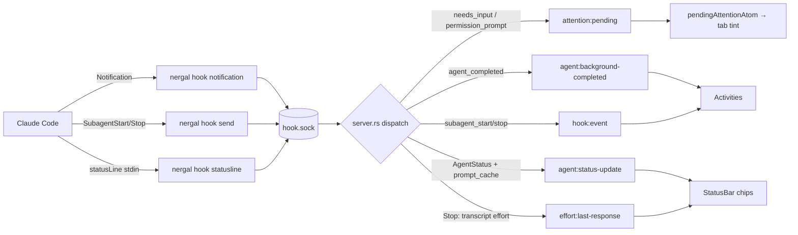

## Context

Nergal observes Claude Code through hooks (`nergal hook ...` → `hook.sock` → `hooks/server.rs` → Tauri events → Jotai atoms) and through the statusline feeder (`nergal hook statusline` → `AgentStatus` → `agent:status-update`). Three CC additions are not wired:

| Data | Source (verified) | Since |
|---|---|---|
| `agent_needs_input`, `agent_completed` | `Notification` hook, `notification_type` field. Fires for background sessions in agent view, teammate setup questions and auto-mode notices (hooks.md "Notification") | v2.1.198 |
| Subagent lifecycle | `SubagentStart {agent_id, agent_type}`, `SubagentStop {agent_id, agent_type, agent_transcript_path, last_assistant_message, effort?}` (hooks.md). No parent id field | v2.0.43 / v2.1.69 |
| `prompt_cache` | statusline stdin object: `warm, caching_observed, ttl, expires_at, requests, misses, expected_rebuilds, hit_ratio, cache_write_tokens, miss_recache_tokens, last_miss_at, last_miss_cause{causes[]}, miss_causes, recache_tokens_if_cold` (statusline.md "Prompt cache fields") | v2.1.251 / v2.1.260 |
| Per-message effort | top-level `effort` string on `type: "assistant"` transcript records; a sibling `perTurnEffort` may be `null` (observed in local transcripts, CC 2.1.289) | v2.1.212 |

Constraints: another session refactors `setup.rs::run()` (FRI-498), so `setup.rs` changes stay inside the `HOOKS` table and its tests. Focus freeze: Claude Code only.

## Goals / Non-Goals

**Goals:**
- A background agent waiting for input lights the same attention tint as AskUserQuestion.
- Subagent start/finish appear in Activities, paired by `agent_id`.
- The status bar shows prompt-cache hit ratio, cold state and last miss cause.
- The status bar shows the effort the last response actually ran at.
- Every parser tolerates absent fields.

**Non-Goals:**
- Nested subagent trees. Payloads carry no parent agent id.
- A `subagentStatusLine` feeder.
- Persisting any of this data in SQLite.

## Decisions

### D1. Widen the existing Notification matcher, keep one entry

`HOOKS` changes the `Notification` matcher to `permission_prompt|agent_needs_input|agent_completed`. `merge_hook` already upgrades a matcher in place when the command matches, so users get the new types on the next `nergal setup` without a duplicate entry.

- Alternative: a second Notification entry per type. Rejected: two entries share one command, and `merge_hook` keys entries by command, so it would flip-flop the matcher.
- Alternative: no matcher (all types). Rejected: `idle_prompt`, `auth_success` and the elicitation types would spawn the binary for no consumer.

### D2. Split attention vs completion in the backend

`HookEvent::Notification` keeps one variant. `mcp_mode()` returns `needs_attention` for every type except `agent_completed`, which returns `None`. The dispatcher emits `attention:pending` for attention types and `agent:background-completed` for `agent_completed`.

Clearing: a permission prompt is answered in the same session, so a PostToolUse clears it. A background agent is answered in agent view, so the Nergal session may fire no other event. Therefore `agent_completed` also clears, but only a wait that `agent_needs_input` set. A pending plan review, AskUserQuestion or `permission_prompt` in the main session stays.

- Frontend: `pendingAttentionAtom` stores the notification type as its value (was `true`). `agent_completed` deletes the entry only when the value is `agent_needs_input`. Consumers keep reading it as truthy.
- Backend: `waiting_for()` for `agent_needs_input` starts with the fixed prefix `background agent`. `mcp_activity_after_completion` resets the recorded activity to `idle` with no `waiting_for` only when the mode is `needs_attention` and `waiting_for` carries that prefix.

The existing clears (PostToolUse, Stop, prompt submit, session end) stay.

- Alternative: a per-session source marker in `AgentRuntimeState`. Rejected: the prefix needs no new state and the descriptor already exposes `waiting_for`.

- Alternative: emit `attention:pending` for all and branch in React. Rejected: the MCP descriptor mode is computed in Rust and would still flip to `needs_attention`.

### D3. Subagent hooks through the generic `send` path

`SubagentStart` / `SubagentStop` become new `HookEvent` variants with optional fields, delivered by `nergal hook send subagent-start|subagent-stop` (async). The matcher `.+` is a regex (contains `.`/`+`) that never matches an empty `agent_type`, so CC internal agents (prompt suggestions, `/btw`) do not spawn the hook. The server also drops empty `agent_type` for older CC builds that ignored matchers on empty types (fixed in v2.1.275). The drop happens at the top of `process_event`, before orphan registration, MCP activity, or any emit.

`FrontendHookEvent` gains optional `agent_id`, `agent_type`, `agent_message`, `effort_level` fields, skipped when `None`. React pairs `subagent_stop` with the running entry of the same `agent_id`.

- Alternative: reuse `tool_name` for `agent_type` and `stop_reason` for the message. Rejected: two meanings per field is a known incoherence (the `permission_denied` reason slot already does this).
- Alternative: derive subagents from `PreToolUse[Agent]`. Rejected: background subagents finish long after the tool returns; only `SubagentStop` marks the real end.

Dedup with the `Agent` tool row: `PreToolUse` is unmatched, so the `Agent` (older CC: `Task`) tool call already adds a running `tool_use` row. `Agent` is not in the PostToolUse matcher, so that row only closes through the any-name fallback of `completeToolActivityAtom`, often by an unrelated tool. On `subagent_start`, React converts the newest running `Agent`/`Task` row (not yet claimed by an agent id) into the subagent row: type `subagent`, the agent id, the new label. With no such row, it appends a new one. Without subagent hooks installed, the old behaviour is unchanged. Hooks are async, so a parallel tool's PostToolUse could close the `Agent` row through the any-name fallback before SubagentStart arrives. `completeToolActivityAtom` therefore never closes an `Agent`/`Task` row through the fallback; only a same-name PostToolUse closes it.

- Alternative: hide `Agent` rows when subagent hooks are installed. Rejected: the frontend cannot know which hooks the user's settings hold.
- Alternative: keep both rows. Rejected: duplicate rows, and the tool row closes at a wrong time.

### D4. Nested `prompt_cache` object in `AgentStatus`

`statusline_to_agent_status` adds `prompt_cache` (or `null`). It flattens `last_miss_cause.causes` into `last_miss_causes: string[]` and drops the count maps the UI does not use. Every key of the object is always emitted; an absent or mistyped source field becomes `null` (`last_miss_causes` becomes `[]`). `HookEvent::AgentStatus` gets `#[serde(default)] prompt_cache: Option<PromptCacheStatus>` with every inner field optional, so an older feeder still deserializes.

Miss cause wording (documented ids, statusline.md "Last miss cause"):

| Cause id | Tooltip text |
|---|---|
| `tools_changed` | tool definitions changed |
| `system_prompt_changed` | system prompt changed |
| `ttl_expired_5m` | idle past the 5m TTL |
| `ttl_expired_1h` | idle past the 1h TTL |
| `likely_server_side` | likely server-side eviction |
| any other id | the id with `_` replaced by spaces |

Several causes join with `, `.

- Alternative: flat `cache_*` fields on `AgentStatus`. Rejected: ten new top-level optionals bloat a struct that Pi/Codex never fill.

### D5. Last-response effort read at `Stop`

The `Stop` arm already reads the whole transcript for cost (`parse_cost_from_transcript`). A single pass now also keeps the last assistant `effort`. The backend emits `effort:last-response` when found. React stores it per session and clears it on `user_prompt_submit`, so a stale value never contradicts a fresh `/effort` change during the next turn. The chip shows the statusline setting first and appends `ran <x>` on mismatch; the tooltip reads `Setting: <a>` and `Last response: <b>`.

- Alternative: read the transcript tail inside the statusline feeder. Rejected: the feeder runs on every TUI render; a file read per render is waste.
- Alternative: use `effort.level` from hook payloads. Rejected: it is the setting in effect, the same value the statusline already shows, not the recorded per-message value.

### D6. One activity type `subagent`

`ActivityEntry.type` gains `subagent` with a new optional `agentId`. Color reuses `sky-400` (design.md §1.2 "active, not-yet-busy" → an agent working on its own). The filter chip list includes it.

## Risks / Trade-offs

- [`agent_needs_input` fires in the agent view process, which may not carry `NERGAL_SESSION_ID`] → `nergal hook notification` already returns early without it; nothing breaks, the signal is simply absent. Manual walk confirms.
- [Transcript lags the turn at `Stop` (hooks.md says writes are async)] → the effort may reflect the previous message. Effort rarely changes per message; the tooltip labels it "Last response".
- [Attention for `agent_needs_input` may outlive the wait when the background agent is answered in agent view and never completes] → `agent_completed` clears it; PostToolUse / Stop / prompt submit / session end also clear it. A wait answered without any of these keeps the tint until the next turn event.
- [Last writer wins on the attention source: `permission_prompt` pending, then `agent_needs_input`, then `agent_completed` clears the tint while the prompt is still on screen] → rare; the next PostToolUse re-syncs. Accepted to keep one attention slot per session.
- [Subagent hooks add two process spawns per subagent] → async hooks, matcher `.+` skips internal agents.
- [Concurrent edit of `setup.rs` by FRI-498] → edits limited to the `HOOKS` table and new tests.

## Migration Plan

No data migration. Users run `nergal setup` (or the app runs it) to upgrade the Notification matcher and add the subagent hooks. Rollback: revert the commit; stale `SubagentStart`/`SubagentStop` entries would then fail to deserialize server-side and be dropped like any unknown event.

## Open Questions

- Should the cold marker also tint the chip (e.g. `text-yellow-500`)? Default: word only, no new color encoding.
