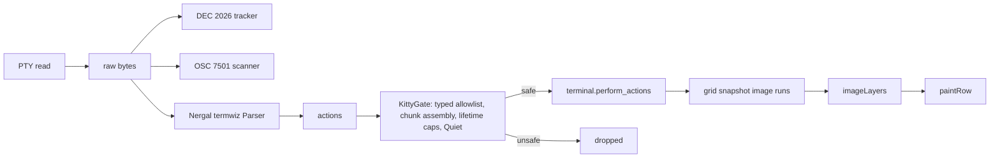

## Context

wezterm-term (git tag `20240203-110809-5046fc22`) implements kitty graphics; Nergal keeps it off (`WZ/term/src/config.rs:175`). Turning it on as it ships is unsafe (`~/.claude/projects/-home-felipe-Projects-cluihud/work/kitty-graphics/analysis.md`): file and temp-file media read any file and delete under a non-canonical `/tmp` prefix; shared memory is unlinked; the query runs the same loader; compression, `S=` and the chunk accumulator have no cap; degenerate placements divide by zero and the release build aborts.

Plan review round 1 (handoff/iprev/round1-review.md) showed that a byte-level filter cannot match wezterm's parser: in an APC, BEL is data and any `ESC`, C1 byte, CAN or SUB dispatches it; vtparse ignores bytes a scanner would see; wezterm's key parser keeps the last duplicate and parses `w=00` as 0. Every such difference is a bypass. It also found a division by zero without `w=0` (`x >= W`), memory amplification from repeated id-0 placements (`attach_image` appends per cell), PNG decode amplification, and kitty replies for `I=` transmissions.

The user decided (2026-11-26): kitty before FRI-624; the protection lives in Nergal, not in a fork; the `a=q` answer stays off until FRI-624.

## Goals / Non-Goals

**Goals:** safe kitty placements from direct RGB/RGBA data (chafa `-f kitty`); no file access, reply or crash from PTY output through kitty, and kitty memory bounded per terminal by a lifetime cap; correct z layering.

**Non-Goals:** the `a=q` answer, Unicode placeholders and Claude Code images (FRI-624); PNG (`f=100`), compression, file/temp/shm media, animation; the unbounded APC buffer of vtparse, which holds any APC (kitty included) until its terminator before the gate sees it (pre-existing with or without kitty; FRI-629).

## Decisions

### D1. Nergal owns the parser and gates typed actions

`TerminalSession` keeps its own `termwiz::escape::parser::Parser` (same wezterm revision, `termwiz` is a direct dependency) and replaces `self.terminal.advance_bytes(bytes)` with `parser.parse(bytes, ..)` → `KittyGate::admit(actions)` → `self.terminal.perform_actions(actions)` (`WZ/term/src/terminal.rs:164-173`). The gate sees exactly the actions wezterm would have performed, so there is no parsing difference to exploit: terminators, ignored bytes, nesting, duplicate keys and numeric spellings are all resolved by the same code before the gate decides on typed values. Parsing does not touch the file system (`load_data` runs only in `kitty_img`). The byte-level DEC 2026 tracker and OSC 7501 scanner keep running on the raw bytes as today.

Alternatives: a byte-level filter (rejected in iprev round 1: it must replicate vtparse exactly, and every divergence is a file read or delete); a fork of wezterm (rejected by the user).

### D2. Typed allowlist

- Transmission (`TransmitData`, `TransmitDataAndDisplay`): `KittyImageData::Direct` or `DirectBin`, compression none, format `Rgb`, `Rgba` or none (kitty's default is RGBA), width and height in 1..=4096, `image_number` none; the decoded length must equal width × height × bpp exactly.
- Placement (`TransmitDataAndDisplay`, `Display`): `Display` needs `image_id >= 1` and no `image_number`; explicit `columns` in 1..=terminal cols and `rows` in 1..=terminal rows (without them the footprint depends on cell pixels and can reach millions of cells; chafa always sends both); `x` and `y` absent or 0; explicit `w`/`h` above zero. With the origin fixed at 0, wezterm's drawn width and height are at least 1 for any image it holds (sixel and iTerm2 cache only images with dimensions of at least 1, and kitty never caches empty data), so the divisor at `image.rs:98, 114` cannot be zero. The product before that division (`cols * cell_pixel_width * image_width`) uses the cached image's width: a crafted sixel can make it pass `u32`. In release builds it wraps and the image is drawn wrongly; in debug builds (`cargo test`, `pnpm tauri dev`) it panics. Accepted: debug builds are developer-only. The gate does not keep image dimensions: wezterm's image cache is keyed by the pixel bytes only (`termwiz/src/image.rs:304-310`), so it can hand back an older image with other dimensions (`term/src/terminalstate/image.rs:257-270`), and any check against the gate's own dimensions could be wrong (iprev round 3). A placement of an id wezterm does not hold only logs an error there.
- `Delete`: only `All` and `ByImageId`, the variants wezterm implements (others only log).
- Everything else (`Query`, `TransmitFrame`, `ComposeFrame`, other media, compression, PNG) is dropped.
- Every forwarded action gets `KittyImageVerbosity::Quiet`; wezterm returns before writing any reply (`kitty.rs:366-368`).
- `U=1` cannot be filtered: termwiz does not parse `U` at this revision, so a `U=1` transmission is an ordinary direct transmission and is placed normally. Accepted until FRI-624: only Claude Code sends it, and it does not while the query stays unanswered.

### D3. The gate assembles chunks

A transmission with `more_data_follows` starts a transfer in the gate. A continuation is a `TransmitData` whose fields are all default except direct data and the more-data flag; anything else (another kitty action, a continuation with other keys or a non-direct medium) drops the transfer, and the new action is then judged on its own. The gate decodes each chunk's base64 separately (as wezterm does), caps the collected bytes at the declared size, checks the exact size on the final chunk, and forwards one action with `DirectBin(decoded)` and `more_data_follows` false. A single-chunk transmission is also forwarded as `DirectBin(decoded)`. The gate decodes with the standard alphabet and canonical padding, rejecting trailing bits, which is at least as strict as wezterm's decoder (`termwiz/src/escape/osc.rs:1233-1242`), so a size the gate accepts is a size wezterm accepts. wezterm's accumulator is never used. The in-flight transfer is bounded by the 64 MiB maximum image size.

### D4. Lifetime caps instead of tracking wezterm's memory

The user set the invariant (2026-11-26, convergence rule after review rounds 1 and 2): PTY output can never grow Nergal's memory without bound through kitty.

wezterm's deletes are not exact (they detach only on the active screen and only in the rows recorded at placement time; screen switches, IL/DL, scroll regions and resize leave orphaned cells), and its 16-entry image cache keeps recent images after a delete. A gate that models wezterm's live memory diverges, and every divergence is unbounded memory (iprev round 2). So the gate does not model it. It counts, per terminal and for the terminal's whole life: image bytes (each transmission at the larger of width × height × 4, because wezterm stores RGB as RGBA, and 4 KiB, which covers the fixed cost of each wezterm and gate entry); placed cells (columns × rows per placement); and the number of transmissions, placements and deletes. Everything wezterm retains for kitty comes from forwarded actions, so retained memory is bounded by the forwarded totals. The count caps also bound CPU: stacking k placements on one cell costs O(k²) clones in `assign_image_to_cells`, and each delete walks every placement key (iprev round 3). Caps (user, 2026-11-26, low caps with a notice): 256 MiB, 131,072 cells, 4096 transmissions, 1024 placements, 4096 deletes. An `a=T` counts as one transmission and one placement and is dropped whole if either would pass. Deletes keep passing after the other caps, up to their own cap, so a program can still remove what it drew.

What fits: 256 MiB is about 8 full-screen images on a 4K canvas (3840 × 2000 × 4 ≈ 30 MiB each) or about 47 on 1080p, per terminal life; small images such as Claude Code charts fit by the hundreds. Reaching a cap shows a notice once (a Tauri event that the frontend turns into a toast: kitty images are paused in this terminal until it is reopened).

CPU worst case in wezterm: stacking placements clones each covered cell's image list, so the total is bounded by cells cap × placements cap / 2 ≈ 6.7 × 10⁷ clones, once. In Nergal's snapshot, the open runs are indexed by their merge key, so each cell's images cost O(1) and a stack does not repeat a quadratic cost on every frame.

Worst case per terminal, in bytes: 256 MiB of image data; about 131,072 × 200 B ≈ 25 MiB of image cell entries (a boxed `ImageCell`, its vector slot and the cell's fat attributes); 4096 map entries in wezterm (negligible); one in-flight transfer of at most 64 MiB plus its decoded copy (128 MiB). About 410 MiB per terminal, times the open terminals (sessions, quake shells, and sessions an agent creates through MCP `create_worktree_session`). Transient copies come on top while an image is in flight: the RGB to RGBA conversion, the IPC copy of `payload_for_bounded`, the WebKit `ImageData`/`ImageBitmap`, and the per-frame clone of the visible cells' image lists. Parts of this (wezterm's `id_to_data`, its 16-entry image cache) are private and not observable in tests; the bound for them rests on this arithmetic, and the tests observe the cells. When a cap is reached, the terminal drops every later kitty action and logs once. A new terminal (new session or quake shell) starts at zero.

Retransmitting to an existing id, `i=0`, and orphaned cells all stay inside the bound, because each forwarded transmission and placement is counted when it is forwarded and never refunded.

### D6. Mechanical guard against bypassing the gate

`src-tauri/clippy.toml` (create if missing) adds `disallowed-methods` for `wezterm_term::Terminal::advance_bytes`, with the reason "PTY bytes go through TerminalSession's parser and KittyGate". `cargo clippy -D warnings` already runs in CI, so a future direct call fails the build. The parser comparison test calls `Terminal::advance_bytes` on purpose, under a `#[allow(clippy::disallowed_methods)]` scoped to that test.

### D5. Painter layers in a pure module

`imageLayers.ts` splits a row's runs into `underBackground` (`z < -1073741824`), `underText` (`-1073741824 <= z < 0`) and `overText` (`z >= 0`), each stably sorted by z. `paintRow` clears the row, draws `underBackground`, then all cell backgrounds, then `underText`, then glyphs and underlines (keeping the wide-cell skip), then `overText`. Drawing all backgrounds before glyphs changes one thing: a glyph that overhangs into the next cell is no longer covered by that cell's background. That is the usual terminal rendering and is accepted.

## Risks / Trade-offs

- [Parser state moves to Nergal] → the emulator's own parser is never used again; `perform_actions` is the same performer `advance_bytes` uses. Tests compare ordinary output against the emulator's own parser.
- [A busy terminal stops showing new kitty images] → after 256 MiB of images, 524,288 placed cells or 4096 transmissions, placements or deletes in its life; reopening the terminal resets it. Expected to be rare in interactive use.
- [Two images with the same bytes and different dimensions] → wezterm's cache returns the first one's dimensions, so the second draws with the wrong size. Upstream bug; the gate keeps it from crashing (x/y at 0) but does not fix the drawing. Accepted.
- [PNG kitty images do not show] → senders that use `f=100` fall back to nothing; chafa uses RGBA. PNG can be added later with an IHDR size check.
- [Deleted placements stay visible] → wezterm's inexact deletes can leave an image visible on the other screen or after a resize; memory stays bounded by D4. Accepted.
- [Unbounded APC buffer in vtparse] → pre-existing, unchanged by this change; FRI-629.

## Migration Plan

No data migration. Runtime kill switch: with `NERGAL_DISABLE_KITTY=1` in Nergal's environment, the gate drops every kitty action, without a release. Rollback: `enable_kitty_graphics` false and the gate drops every kitty action, in a release. Reverting the parser swap also needs a release; it is behavior-neutral and covered by the comparison tests.

## Open Questions

None.
