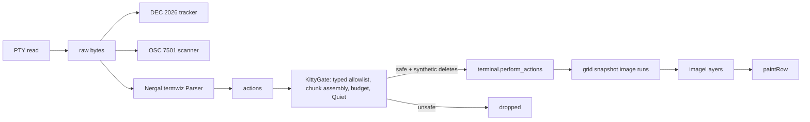

## Context

wezterm-term (git tag `20240203-110809-5046fc22`) implements kitty graphics; Nergal keeps it off (`WZ/term/src/config.rs:175`). Turning it on as it ships is unsafe (`~/.claude/projects/-home-felipe-Projects-cluihud/work/kitty-graphics/analysis.md`): file and temp-file media read any file and delete under a non-canonical `/tmp` prefix; shared memory is unlinked; the query runs the same loader; compression, `S=` and the chunk accumulator have no cap; degenerate placements divide by zero and the release build aborts.

Plan review round 1 (handoff/iprev/round1-review.md) showed that a byte-level filter cannot match wezterm's parser: in an APC, BEL is data and any `ESC`, C1 byte, CAN or SUB dispatches it; vtparse ignores bytes a scanner would see; wezterm's key parser keeps the last duplicate and parses `w=00` as 0. Every such difference is a bypass. It also found a division by zero without `w=0` (`x >= W`), memory amplification from repeated id-0 placements (`attach_image` appends per cell), PNG decode amplification, and kitty replies for `I=` transmissions.

The user decided (2026-11-26): kitty before FRI-624; the protection lives in Nergal, not in a fork; the `a=q` answer stays off until FRI-624.

## Goals / Non-Goals

**Goals:** safe kitty placements from direct RGB/RGBA data (chafa `-f kitty`); no file access, reply, crash or unbounded memory from PTY output through kitty; correct z layering.

**Non-Goals:** the `a=q` answer, Unicode placeholders and Claude Code images (FRI-624); PNG (`f=100`), compression, file/temp/shm media, animation; the unbounded APC buffer of vtparse for non-kitty APCs (pre-existing with or without kitty; tracked separately).

## Decisions

### D1. Nergal owns the parser and gates typed actions

`TerminalSession` keeps its own `termwiz::escape::parser::Parser` (same wezterm revision, `termwiz` is a direct dependency) and replaces `self.terminal.advance_bytes(bytes)` with `parser.parse(bytes, ..)` → `KittyGate::admit(actions)` → `self.terminal.perform_actions(actions)` (`WZ/term/src/terminal.rs:164-173`). The gate sees exactly the actions wezterm would have performed, so there is no parsing difference to exploit: terminators, ignored bytes, nesting, duplicate keys and numeric spellings are all resolved by the same code before the gate decides on typed values. Parsing does not touch the file system (`load_data` runs only in `kitty_img`). The byte-level DEC 2026 tracker and OSC 7501 scanner keep running on the raw bytes as today.

Alternatives: a byte-level filter (rejected in iprev round 1: it must replicate vtparse exactly, and every divergence is a file read or delete); a fork of wezterm (rejected by the user).

### D2. Typed allowlist

- Transmission (`TransmitData`, `TransmitDataAndDisplay`): `KittyImageData::Direct`, compression none, format `Rgb` or `Rgba`, width and height in 1..=4096, `image_number` none; the decoded length must equal width × height × bpp exactly.
- Placement (`TransmitDataAndDisplay`, `Display`): the image is one the gate forwarded and tracks (its size known); `x < width`, `y < height`; explicit `w`/`h` above zero; `columns <= terminal cols`, `rows <= terminal rows`.
- `Delete`: forwarded (it only removes).
- Everything else (`Query`, `TransmitFrame`, `ComposeFrame`, other media, compression, PNG, other formats) is dropped.
- Every forwarded action gets `KittyImageVerbosity::Quiet`, so wezterm never writes a reply.

### D3. The gate assembles chunks

A transmission with `more_data_follows` starts a transfer in the gate. Continuation chunks append their payload; the transfer is capped at the base64 length of its declared size. On the final chunk the gate decodes, checks the exact size and forwards one complete action with `more_data_follows` false. An oversize chunk or any other kitty action before the final chunk drops the transfer whole. wezterm's accumulator is never used, so it cannot desynchronize or grow.

### D4. Budget with eviction

Per terminal: at most 256 MiB decoded, 1024 live placements, 131072 placed cells (sum of columns × rows over live placements). The gate tracks images in forwarding order with their decoded size and placements. Before forwarding an action that would pass a limit, it injects `Delete` (by image id, freeing data) for the oldest images until the action fits. A transmission without an image id gets a private id from a reserved high range, so every image can be deleted; this also stops id-0 placements from stacking on the same cells. A placement that replaces itself (same id and placement id, or same id without a placement id, which wezterm treats as "remove all of this image's placements first", `kitty.rs:103-105`) updates its entry instead of adding one.

### D5. Painter layers in a pure module

`imageLayers.ts` splits a row's runs into `underBackground` (`z < -1073741824`), `underText` (`-1073741824 <= z < 0`) and `overText` (`z >= 0`), each stably sorted by z. `paintRow` clears the row, draws `underBackground`, then all cell backgrounds, then `underText`, then glyphs and underlines (keeping the wide-cell skip), then `overText`. Drawing all backgrounds before glyphs changes one thing: a glyph that overhangs into the next cell is no longer covered by that cell's background. That is the usual terminal rendering and is accepted.

## Risks / Trade-offs

- [Parser state moves to Nergal] → the emulator's own parser is never used again; `perform_actions` is the same performer `advance_bytes` uses. Tests compare ordinary output against the emulator's own parser.
- [Eviction makes old images disappear] → only past 256 MiB / 1024 placements / 131072 cells per terminal; expected to be rare in interactive use.
- [PNG kitty images do not show] → senders that use `f=100` fall back to nothing; chafa uses RGBA. PNG can be added later with an IHDR size check.
- [Deleted placements in scrollback] → wezterm's delete detaches the image from the cells it tracks; the builder verifies scrollback cells are freed too, or the budget accounts for it.
- [Unbounded non-kitty APC buffer in vtparse] → pre-existing, unchanged by this change; tracked as a separate issue.

## Migration Plan

No data migration. Rollback: `enable_kitty_graphics` false and the gate drops every kitty action; the parser swap stays (it is behavior-neutral and covered by the comparison tests).

## Open Questions

None.
