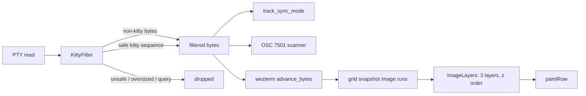

## Context

wezterm-term (git tag `20240203-110809-5046fc22`) implements kitty graphics; Nergal keeps it off (`WZ/term/src/config.rs:175`). The analysis in `~/.claude/projects/-home-felipe-Projects-cluihud/work/kitty-graphics/analysis.md` found that turning it on as it ships is unsafe: `t=f`/`t=t` read any file and `t=t` deletes under a non-canonical `/tmp` prefix check; `t=s` unlinks any shared memory; `a=q` runs the same loader; `o=z`, `S=` and the chunk accumulator have no cap; `w=0` with `c=` divides by zero and the release build aborts. Nergal's FRI-611 pipeline already snapshots several images per cell with their z, and the canvas paints runs before and after glyphs.

The user decided (2026-11-26): kitty before FRI-624; a filter in Nergal, not a fork; the `a=q` answer stays off until FRI-624 adds Unicode placeholders.

## Goals / Non-Goals

**Goals:** safe kitty placements from direct data (chafa `-f kitty`, other tools that send direct data); correct z layering; no app crash, file access or unbounded memory from PTY output.

**Non-Goals:** the `a=q` answer, Unicode placeholders and Claude Code images (FRI-624); file, temp-file and shared-memory media; compression; animation; delete variants wezterm does not implement (they already only log); yazi auto-detection (needs the query).

## Decisions

### D1. Filter in Nergal, not a fork

A `KittyFilter` in `terminal/kitty_filter.rs` rewrites the PTY byte stream: it passes everything except kitty APC sequences, which it buffers whole and then forwards or drops. Alternatives: a `[patch]` fork of termwiz/term fixing `load_data` and the panic (rejected by the user: a large dependency to maintain), or keeping kitty off (no value).

### D2. Position in `advance_bytes`

The filter runs first. Its output feeds `track_sync_mode`, the OSC 7501 scanner and `terminal.advance_bytes`, so every downstream consumer sees the same bytes. A kitty sequence cannot contain the OSC 7501 or DEC 2026 bytes, so ordering does not change their results. The OSC 7501 reply still goes to the write queue before wezterm parses the chunk.

### D3. Buffering and latency

Bytes outside a kitty sequence pass in the same call. A kitty sequence is held until its terminator arrives, so only that sequence waits for the next PTY read. A trailing `ESC` or `ESC _` at the end of a chunk is held until the next byte decides it. CAN (`0x18`) or SUB (`0x1a`) inside a held sequence aborts it, like vtparse does; the filter drops the held bytes and passes the CAN/SUB. A sequence over 64 KiB is dropped as soon as it passes the limit, and the filter skips to its terminator without holding more.

### D4. Caps

- 64 KiB per sequence: the kitty spec sends large images in chunks of at most 4096 bytes, and chafa uses 4096-byte chunks. A larger single sequence is not produced by conforming senders.
- 128 MiB of payload per transfer: base64 of 96 MiB, just under wezterm's 100 MB per-image check (`WZ/term/src/terminalstate/image.rs:273-290`). When a transfer passes it, the filter drops the rest of its chunks and forwards one synthetic final chunk `ESC _ G m=0 ESC \`, so wezterm coalesces and discards its accumulator instead of keeping partial data (its accumulator is otherwise never reset). The builder verifies that wezterm drops a transfer whose size does not match `s*v` and does not attach it.

### D5. Drop whole sequences, never strip keys

Removing a key would change the meaning of the sequence (for example `t=f` without `t` becomes direct data whose payload is a path). Dropping is the only safe rewrite. A dropped first chunk marks its transfer as dropped until `m=0`.

### D6. Key parsing

Keys are parsed with wezterm's grammar: `G`, then `k=v` pairs separated by `,` up to `;`, then the payload. A key without `=` makes wezterm drop the sequence (`apc.rs:1073-1076`), so the filter drops it too. Unknown keys pass.

### D7. Three layers in a pure module

`imageLayers.ts` splits a row's runs into `underBackground`, `underText` and `overText`, each sorted by z with a stable sort. `paintRow` draws `underBackground` after the row clear, cell backgrounds, then `underText`, then glyphs and underlines, then `overText`. Today all negative z runs are drawn before the backgrounds, so a colored cell hides them.

## Risks / Trade-offs

- [Memory from many large referenced images] → wezterm's 320 MB budget prunes only unreferenced images; the filter caps each transfer. Accepted residual: many distinct placed images could still use a lot of memory, as with sixel today.
- [A sender that does not chunk] → dropped (D4); chafa and kitty's reference sender chunk.
- [yazi does not pick kitty] → expected until FRI-624 answers the query.
- [Filter bug drops normal output] → tests cover non-kitty APC, split sequences and plain text around dropped sequences.

## Migration Plan

No data migration. Rollback: turn `enable_kitty_graphics` off; the filter then only drops kitty sequences that wezterm would ignore anyway.

## Open Questions

None.
