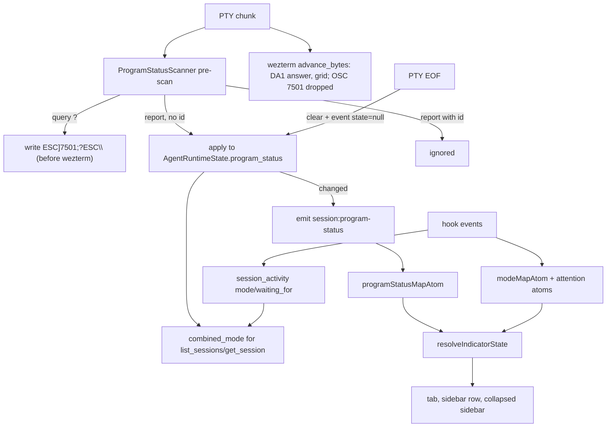

## Context

Claude Code 2.1.295+ implements the Program Status Protocol (OSC 7501). Facts from the 2.1.332 binary are in `~/.claude/projects/-home-felipe-Projects-cluihud/work/osc7501/research.md`; Nergal hook points are in `nergal-side.md` in the same folder.

- Claude Code sends `ESC ] 7501 ; ? ST` in its startup probe batch, together with XTVERSION and `CSI ? u`, and closes the batch with DA1 (`CSI c`). It turns the protocol on only if an OSC 7501 reply whose data starts with `?` arrives before the DA1 answer. No env var or `TERM_PROGRAM` is involved, so the FRI-611 decision not to set `TERM_PROGRAM` stands.
- Reports look like `ESC ] 7501 ; state=<s>:app=claude-code[:id][:kind][:progress][:title][:msg] ST`. `title` and `msg` are base64. The root (the session) has no `id`. `state=clear` resets everything.
- Nergal runs wezterm-term (git tag `20240203-110809-5046fc22`). termwiz parses OSC 7501 as `OperatingSystemCommand::Unspecified`, and wezterm drops it without drawing. wezterm offers no callback for unknown OSC codes.
- Today the state comes from hooks only. React keeps `modeMapAtom` (tool name, `active`, `idle`) and three attention sources. The hook server mirrors a coarse mode (`running`, `idle`, `needs_attention`) into `AgentRuntimeState.session_activity` for the MCP directory.

## Goals / Non-Goals

**Goals:**
- Claude Code turns OSC 7501 on inside Nergal.
- The root status drives the session indicator and the MCP `mode`, which closes the post-`Stop` background gap and the folder-trust gap.
- `done` and `error` become visible states.
- Behavior without OSC 7501 stays exactly as today.

**Non-Goals:**
- Child entries (`id`), `progress` and `title`.
- Showing `msg` in the UI (for example as a tooltip).
- Rehydrating the status after a frontend reload. The hook-derived atoms are not rehydrated either.
- Codex, OpenCode and Pi: frozen, and they send no OSC 7501.

## Decisions

### D1. Byte pre-scan in `TerminalSession::advance_bytes`

A new scanner, `ProgramStatusScanner`, runs on each PTY chunk before `terminal.advance_bytes`, like `track_sync_mode` does for DEC 2026. It returns the queries and reports it found. The bytes still go to wezterm unchanged, and wezterm drops them.

- Alternative: patch wezterm-term to forward `Unspecified` OSC through `AlertHandler`. Rejected: it needs a fork of a git dependency for one OSC code.
- Alternative: strip the sequences before wezterm. Rejected: wezterm already drops them, and stripping adds a second rewrite path to the byte stream.

### D2. The query reply is written from the pre-scan, before wezterm parses the chunk

`TerminalSession` gets an optional reply writer: a clone of the same `SharedWriter` that wezterm uses, passed in by `build_terminal_session`. The scanner writes `ESC ] 7501 ; ? ESC \` as soon as a query ends, during the pre-scan. wezterm parses the chunk afterwards, so its DA1 answer for the same chunk is written later, under the same writer mutex. Claude Code then sees the 7501 reply first.

- Alternative: return the query to the reader thread and write the reply there. Rejected: the reader thread calls `advance_bytes` once per chunk, so the reply would come after wezterm's DA1 answer for that chunk.
- The reply is sent in every terminal, quake shells included, because it only states a capability. Shells never send the query.

### D3. Split reports and the byte cap

The scanner is a small state machine: it looks for the prefix `ESC ] 7501 ;`, then collects the body until BEL or `ESC \`. A partial prefix or body carries over to the next chunk. A body longer than 4096 bytes is dropped, and the scanner skips to its terminator. 4096 covers the largest Claude Code report: a 2048-byte `msg` is about 2732 base64 bytes, plus a 192-byte `title` (about 256) and the other fields.

- Alternative: a fixed tail like `sync_tail` (7 bytes). Rejected: a report body can be kilobytes long.

### D4. One root status per session in `AgentRuntimeState`

`AgentRuntimeState` gets a `program_status` map: Nergal session id → `ProgramStatus { state, kind, msg }`. The reader thread of an agent PTY applies each report (`set` or `clear`). It emits `session:program-status` only when the stored value changes. PTY EOF clears the entry in `on_agent_pty_eof`. Parsing and the diff are pure functions, so tests cover them without a PTY.

- Alternative: keep the status in `TerminalSession`. Rejected: the MCP directory and the hook server already read `AgentRuntimeState`, not the terminal.

### D5. A dedicated Tauri event, not `hook:event`

The event is `session:program-status` with payload `{session_id, state, kind, msg}`. `state` is `null` when the status is removed. React stores it in a new `programStatusMapAtom`.

- Alternative: fake a `hook:event`. Rejected: `hook:event` listeners run hook side effects (activity log, plan and ask handling) that a status report must not trigger.

### D6. Precedence: the status decides the coarse state, hooks decide detail and attention

The rule is the same in React and in the MCP directory:

1. Attention wins. Its sources are the three hook sources (plan review, pending ask, notification attention) plus root status `blocked`. The hook sources keep their own clearing rules, so a background agent waiting in agent view still shows, although OSC 7501 reports it only as a child.
2. `completed` (the DB-ended session) comes next.
3. With a root status: `error` → error, `done` → done, `idle` → idle, `working` → working (mode is a tool name), thinking (mode `active`), or working (any other mode, for example `idle` after `Stop`).
4. Without a root status: today's order (idle, thinking, working).

The status and the hooks never overwrite each other. Each source keeps its own value, and the resolver combines them at read time. So a late `Stop` hook after a `working` report cannot flip the session to idle, and a late `PostToolUse` after `done` cannot flip it back to working. The resolver is one pure function per side: `resolveIndicatorState` in React and `combined_mode` in Rust.

- Alternative: let the status overwrite `modeMapAtom`. Rejected: it loses the tool name and races with hook delivery.

### D7. MCP mapping keeps the `mode` enum

`working` → `running`. `blocked` → `needs_attention`. `done`, `idle` and `error` → `idle`. Other agents use `mode` to decide whether a session can take a message, and a session in `error` accepts a new prompt. `waiting_for` for `blocked` is the decoded `msg` cut to 200 characters. Without a `msg`, it names the `kind`: `permission`, `question`, `login`, or `dialog` when there is no `kind`.

- Alternative: add `error` or `done` to the enum. Rejected: it changes the MCP contract for a value that callers would treat as `idle` anyway.

### D8. Visuals for `done` and `error`

These are reversible defaults, tokens from `docs/design.md` §3.10, and they are checked in the walk:

- `done`: a static green ring (`ring-1 ring-inset ring-green-500`, transparent center), no animation. It shares the success color with working but differs in shape, so it still differs with reduced motion.
- `error`: a static `bg-red-500` circle, no animation, like the conflict dot without the pulse.

`completed` keeps its Check icon.

## Risks / Trade-offs

- [Claude Code changes the probe or the format] → The parser ignores unknown states and fields. Without reports, Nergal falls back to hooks. The research file names the 2.1.332 symbols to re-check.
- [A stale status if Claude Code dies without `state=clear`] → PTY EOF clears it. If Claude Code exits but the shell stays, the next `claude` sends `state=clear` on its first report. Until then, a `done` or `idle` status remains. Accepted: it matches what the user last saw.
- [The reply goes to a program that did not ask] → It is written only after a query. Only Claude Code sends that query.
- [Writer lock order] → The scanner writes under the same `SharedWriter` mutex wezterm uses, and never while holding another lock that wezterm takes. The reader thread already holds the `TerminalSession` mutex during `advance_bytes`, which is the same as today for wezterm's own answers.
- [Frontend reload loses the status] → The next report restores it. Claude Code only re-sends a report when an entry changes, so an idle session stays on its hook-derived state until it changes. Accepted (non-goal).

## Migration Plan

No data migration. Rollback is a revert: without the reply, Claude Code never turns the protocol on, and everything falls back to hooks.

## Open Questions

None. The user settled the done/error visuals and left child entries out of scope (2026-11-26).
