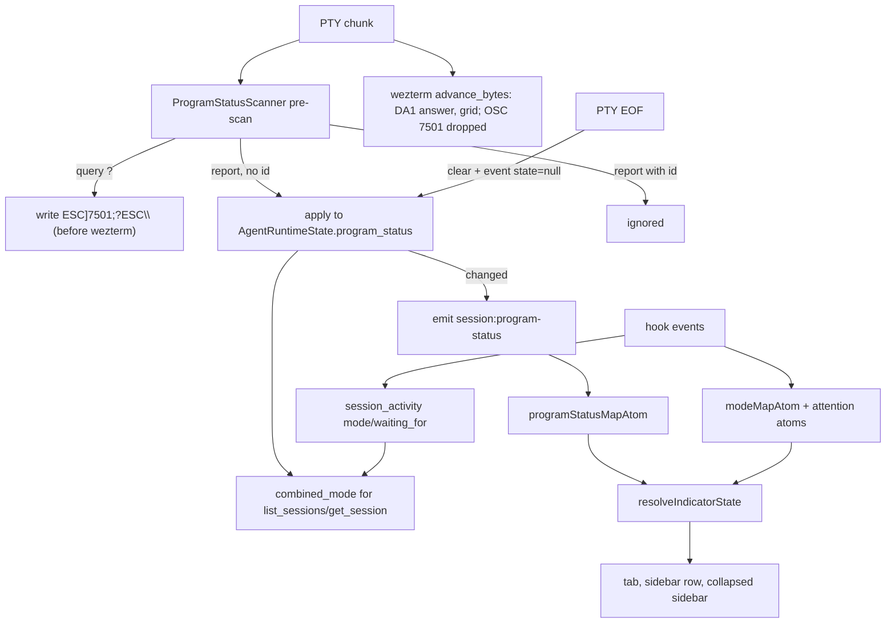

## Context

Claude Code 2.1.295+ implements the Program Status Protocol (OSC 7501). Facts from the 2.1.332 binary are in `~/.claude/projects/-home-felipe-Projects-cluihud/work/osc7501/research.md`; Nergal hook points are in `nergal-side.md` in the same folder.

- Claude Code sends `ESC ] 7501 ; ? ST` in its startup probe batch, together with XTVERSION and `CSI ? u`, and closes the batch with DA1 (`CSI c`). It turns the protocol on only if an OSC 7501 reply whose data starts with `?` arrives before the DA1 answer. No env var or `TERM_PROGRAM` is involved, so the FRI-611 decision not to set `TERM_PROGRAM` stands.
- Reports look like `ESC ] 7501 ; state=<s>:app=claude-code[:id][:kind][:progress][:title][:msg] ST`. `title` and `msg` are base64. The root (the session) has no `id`. `state=clear` resets everything.
- Nergal runs wezterm-term (git tag `20240203-110809-5046fc22`). termwiz parses OSC 7501 as `OperatingSystemCommand::Unspecified`, and wezterm drops it without drawing. wezterm offers no callback for unknown OSC codes.
- Today the state comes from hooks only. React keeps `modeMapAtom` (tool name, `active`, `idle`) and three attention sources. The hook server mirrors a coarse mode (`running`, `idle`, `needs_attention`) into `AgentRuntimeState.session_activity` for the MCP directory.

## Goals / Non-Goals

**Goals:**
- Claude Code turns OSC 7501 on inside Nergal.
- The root status drives the session indicator and the MCP `mode`, which closes the post-`Stop` background gap and the folder-trust gap.
- `done` and `error` become visible states.
- Behavior without OSC 7501 stays exactly as today.

**Non-Goals:**
- Child entries (`id`), `progress` and `title`.
- Showing `msg` in the UI (for example as a tooltip).
- Rehydrating the status after a frontend reload. The hook-derived atoms are not rehydrated either.
- Codex, OpenCode and Pi: frozen, and they send no OSC 7501.

## Decisions

### D1. Byte pre-scan in `TerminalSession::advance_bytes`

A new scanner, `ProgramStatusScanner`, runs on each PTY chunk before `terminal.advance_bytes`, like `track_sync_mode` does for DEC 2026. It returns the queries and reports it found. The bytes still go to wezterm unchanged, and wezterm drops them.

- Alternative: patch wezterm-term to forward `Unspecified` OSC through `AlertHandler`. Rejected: it needs a fork of a git dependency for one OSC code.
- Alternative: strip the sequences before wezterm. Rejected: wezterm already drops them, and stripping adds a second rewrite path to the byte stream.

### D2. The query reply is written from the pre-scan, before wezterm parses the chunk

wezterm never writes from the reader thread: it wraps its writer in a `ThreadedWriter` (a channel plus its own thread, `term/src/terminalstate/mod.rs:448-478`), so a blocked PTY input queue cannot stall output parsing. The reply must keep that property and still arrive before wezterm's DA1 answer.

So Nergal adds one write queue per PTY: `PtyWriteQueue`, an unbounded channel drained by one thread that writes to the `SharedWriter`. `build_terminal_session` gives wezterm a `QueueWriter` (it only sends to the channel) instead of the `SharedWriterAdapter`, and gives `TerminalSession` a second `QueueWriter` on the same channel as its reply sink. The scanner enqueues `ESC ] 7501 ; ? ESC \` during the pre-scan. wezterm parses the chunk afterwards, and its DA1 answer reaches the same channel later through its `ThreadedWriter`. One consumer keeps the channel order, so Claude Code sees the 7501 reply first. Nothing blocks under the `TerminalSession` mutex.

- Alternative: write the reply synchronously to the `SharedWriter` from the pre-scan. Rejected: the reader thread would block on the writer mutex while it holds the session mutex. If a paste blocks the writer because the PTY input queue is full, and Claude Code blocks on stdout, output is never drained (iprev round 1).
- Alternative: return the query to the reader thread and write the reply there. Rejected: the reader thread calls `advance_bytes` once per chunk, so the reply would come after wezterm's DA1 answer for that chunk.
- Everything wezterm writes goes through the queue: query answers, and also every key event (`key_down`, `session.rs:312`), mouse report (`session.rs:449`, `:482`) and focus event (`session.rs:319`). So each keystroke takes one more thread hop than today (wezterm's `ThreadedWriter`, then the queue). A write error stops the queue and with it the keyboard, exactly as a write error stops `ThreadedWriter` today. Pastes and `write_to_session_pty` keep writing to the `SharedWriter` directly.
- The reply is sent in every terminal, quake shells included, because it only states a capability. Shells never send the query.

### D3. Split reports and the byte cap

The scanner is a small state machine: it looks for the prefix `ESC ] 7501 ;`, then collects the body until BEL or `ESC \`. An `ESC` followed by another byte, CAN or SUB aborts the body; the aborting `ESC` is scanned again as a possible prefix start. This deliberately differs from termwiz, whose vtparse dispatches the OSC on any exit from the OSC state: applying a truncated report such as `state=working:msg=QWx` would show a state Claude Code never finished sending. A partial prefix or body carries over to the next chunk. A body longer than 4096 bytes is dropped, and the scanner skips to its terminator or abort. 4096 covers the largest Claude Code report: a 2048-byte `msg` is about 2732 base64 bytes, plus a 192-byte `title` (about 256) and the other fields.

- Alternative: a fixed tail like `sync_tail` (7 bytes). Rejected: a report body can be kilobytes long.

### D4. One root status per session in `AgentRuntimeState`

`AgentRuntimeState` gets a `program_status` map: Nergal session id → `OwnedStatus { pty_id, status: ProgramStatus { state, kind, msg }, set_at }`. The reader thread of an agent PTY applies each report (`set` or `clear`) with its own `pty_id`, and only when that PTY is the session's live PTY (`live_ptys`, set by `mark_live` at reservation, `pty.rs:946`). Such a report replaces any entry, even one owned by an older PTY that has not reached EOF yet: an old PTY's reader only sees EOF when its child exits, so "first owner wins" would hide the new PTY's first reports, and Claude Code does not re-send them. A report from a PTY that is not live is ignored. EOF removes the entry only when that PTY owns it, following `mark_dead_if` (`agents/state.rs:176-179`). An identical report changes nothing, `set_at` included. It emits `session:program-status` only when `state`, `kind` or `msg` changes. PTY EOF of the owner clears the entry in the EOF path. The root status never writes `session_activity`: its own `set_at` feeds `last_activity` in the descriptor (the later of the two), so the messaging `just_idled` window and the hook mode stay untouched. Parsing and the diff are pure functions, so tests cover them without a PTY.

`msg` has its control characters removed when it is parsed, because it reaches other agents as `waiting_for`.

- Alternative: keep the status in `TerminalSession`. Rejected: the MCP directory and the hook server already read `AgentRuntimeState`, not the terminal.

### D5. A dedicated Tauri event, not `hook:event`

The event is `session:program-status` with payload `{session_id, state, kind, msg}`. `state` is `null` when the status is removed. React stores it in a new `programStatusMapAtom`, created with `sessionScopedMapAtom` (`src/stores/sessionScope.ts:3-7`) so `pruneSessionStateAction` reclaims it.

`SessionEnd` removes the status on neither side. `/clear` fires `SessionEnd` then `SessionStart` in the same Claude Code process, and Claude Code only re-sends changed entries, so a removal on one side would leave the UI and the MCP directory out of step. Claude Code's `state=clear` and PTY EOF are the only removals.

- Alternative: fake a `hook:event`. Rejected: `hook:event` listeners run hook side effects (activity log, plan and ask handling) that a status report must not trigger.

### D6. Precedence: the status decides the coarse state, hooks decide detail and attention

The rule is the same in React and in the MCP directory:

1. Attention wins. Its sources are the three hook sources (plan review, pending ask, notification attention) plus root status `blocked`. The hook sources keep their own clearing rules, so a background agent waiting in agent view still shows, although OSC 7501 reports it only as a child.
2. `completed` (the DB-ended session) comes next.
3. With a root status: `error` → error, `done` → done, `idle` → idle, `working` → working (mode is a tool name), thinking (mode `active`), or working (any other mode, for example `idle` after `Stop`).
4. Without a root status: today's order (idle, thinking, working).

The status and the hooks never overwrite each other. Each source keeps its own value, and the resolver combines them at read time. So a late `Stop` hook after a `working` report cannot flip the session to idle, and a late `PostToolUse` after `done` cannot flip it back to working. The resolver is one pure function per side: `resolveIndicatorState` in React and `combined_mode` in Rust.

- Alternative: let the status overwrite `modeMapAtom`. Rejected: it loses the tool name and races with hook delivery.

### D7. MCP mapping keeps the `mode` enum

`working` → `running`. `blocked` → `needs_attention`. `done`, `idle` and `error` → `idle`. Callers of `list_sessions` read `mode` as "can this session take a new prompt", and a session in `error` can. (Message delivery has its own busy rule, D9.) `waiting_for` for `blocked` is the decoded `msg` cut to 200 characters. Without a `msg`, it names the `kind`: `permission`, `question`, `login`, or `dialog` when there is no `kind`.

- Alternative: add `error` or `done` to the enum. Rejected: it changes the MCP contract for a value that callers would treat as `idle` anyway.

### D9. Delivery follows the root status: never in a dialog, never stranded

The user set the invariant (2026-11-26, after two review rounds found new cases in this mechanism): a wake note never lands inside a dialog or a running turn, and a queued message never stays queued while its target accepts a prompt.

One helper, `delivery_busy(agents, sid)`, decides for every PTY delivery path: the send-path wake and the deferred wake (`mcp/messaging.rs:192-200`, `:221-224`), and the `Stop` drain with the worktree-outcome drain (`hooks/server.rs:1103-1119`).

- With a root status: busy exactly when it is `blocked`, or `working` with hook mode `running` or `needs_attention`. `done`, `idle` and `error` are never busy, because the hook mode can be a stale `running`: `reserve_session_pty` records `running` (`pty.rs:946-947`) and `SessionStart` maps to `running`, so a session that only showed the folder-trust prompt never leaves `running` on the hook side. `working` with hook mode `idle` (background work after `Stop`) is not busy, so BUG-08 does not come back. `working` with `needs_attention` stays busy, because Claude Code may report `working` while Nergal's own blocking hooks (plan review) hold the turn.
- Without a root status: today's rule (hook `running` or `needs_attention`).

Not-busy transitions drain. The reader-thread path computes `delivery_busy` before and after each root status change; on busy to not busy it schedules one idle drain after `IDLE_SETTLE_SECS + 1`, skipped if `delivery_busy` is true by then. The `Stop` drain still runs for a target that is not busy. The in-flight guard of `drain_idle` prevents a double paste when both drains meet. Residual race: a dialog that Claude Code opens right after `Stop` is unknown to Nergal until its report arrives; a `Stop` drain that runs before that report can still paste. The window is the PTY output latency, and it exists today.

`schedule_ready_drain(db, agents, delivery, sid, enabled)` takes `SharedDb`, `AgentRuntimeState` and `Arc<dyn SessionDelivery>` like the deferred wake, so tests drive it with `MockDelivery` (`mcp/delivery.rs:333`) and paused tokio time.

- Alternative: use the descriptor's `combined_mode` for delivery. Rejected: it makes background-working sessions busy and strands their messages.
- Alternative: keep the hook rule and only add `blocked`. Rejected in review round 2: the stale hook `running` strands every message sent while the folder-trust prompt was open.

### D10. Pending tint, no notification

Root status `blocked` also sets the pending tint on the tab and the sidebar row (`TopBar.tsx:476`, `SessionRow.tsx:64` compute `isAwaiting`), so the folder-trust prompt is as visible as an AskUserQuestion. It sends no desktop notification: the permission and question hooks already notify, and a second notification for the same prompt would be noise.

### D8. Visuals for `done` and `error`

These are reversible defaults, tokens from `docs/design.md` §3.10, and they are checked in the walk:

- `done`: a static green ring (`ring-1 ring-inset ring-green-500`, transparent center), no animation. It shares the success color with working but differs in shape, so it still differs with reduced motion.
- `error`: a static `bg-red-500` circle, no animation, like the conflict dot without the pulse.

`completed` keeps its Check icon.

## Risks / Trade-offs

- [Claude Code changes the probe or the format] → The parser ignores unknown states and fields. Without reports, Nergal falls back to hooks. The research file names the 2.1.332 symbols to re-check.
- [A stale status if Claude Code dies without `state=clear`] → PTY EOF clears it. If Claude Code exits but the shell stays, the next `claude` sends `state=clear` on its first report. Until then, a `done` or `idle` status remains. Accepted: it matches what the user last saw.
- [The reply goes to a program that did not ask] → It is written only after a query. Only Claude Code sends that query.
- [Write queue on the keyboard path] → Key, mouse and focus reports now pass one more channel after wezterm's own thread. A pty-level test drives `key_down` and a 7501 query through `build_terminal_session` and checks both reach the shared writer in order. The queue thread logs and stops on a write error, like `ThreadedWriter`. The channel is unbounded; its producers are interactive input and query answers. Rollback: hand wezterm the `SharedWriterAdapter` again.
- [`msg` as an injection surface] → Control characters are removed, and `waiting_for` is cut to 200 characters. Any program in the agent PTY can forge a report, which is the same trust level as the hook `message` field today (`hooks/events.rs:323-326`).
- [Frontend reload loses the status] → The next report restores it. Claude Code only re-sends a report when an entry changes, so an idle session stays on its hook-derived state until it changes. Accepted (non-goal).

## Migration Plan

No data migration. Rollback is a revert: without the reply, Claude Code never turns the protocol on, and everything falls back to hooks.

## Open Questions

None. The user settled the done/error visuals and left child entries out of scope (2026-11-26).
