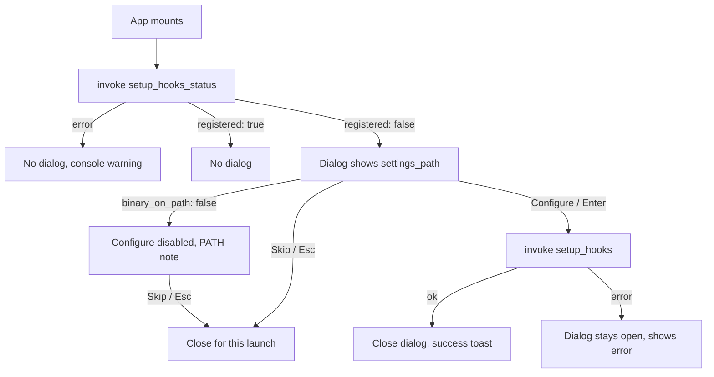

# Design — setup-wizard

## Context

The hook registrar `setup::run()` (`src-tauri/src/setup.rs:155`) is only reachable from the `nergal hook setup` CLI (`src-tauri/src/main.rs:117`). The `setup_hooks` Tauri command (`src-tauri/src/commands/workspaces_sessions.rs:87`) wraps it, but no frontend code invokes it. A fresh install has dead panels.

The first version of this change (2026-06-29) planned a multi-step wizard with a health chip, Settings re-entry and per-OS notes. Re-validation on 2026-10-05 cut it down. Under the focus freeze (Linux + Claude Code), the expected user already has everything installed. The user asked for "configure on first launch and nothing more".

## Goals / Non-Goals

**Goals:**
- A fresh install registers the hooks with one click at launch.
- Installs that already have the hooks see nothing.
- The GUI never writes `~/.claude/settings.json` without consent.

**Non-Goals:**
- Agent, shell, transcripts or keyboard-ownership review.
- A status-bar health chip or a Settings entry.
- Per-OS guidance (Windows and macOS are frozen).
- Any new `Config` field.

## Decisions

### D1 — Trigger on hook state, not on a first-run flag
**Chosen:** probe the hooks at every launch. Open the dialog when they are not registered.
- *Alternative:* a persisted `onboarding_completed` flag (the original D1/D2). Rejected: it needs a new `Config` field, a migration nicety for existing installs (the old D8) and care with the stale-`configAtom` save path. The hook state already answers "does this install need setup?".
- *Trade-off:* a user who skips sees the dialog again on every launch until the hooks exist. Accepted: Nergal without hooks is broken, so asking again is correct. It also covers the regression case (hooks removed later) without a health chip.

### D2 — "Registered" means "setup would change nothing"
**Chosen:** the probe runs the same merge steps as `setup::run()` on an in-memory copy of the settings. `registered` is `true` when no hook would be added or have its matcher upgraded (`merge_hook` returns `true` for both, `setup.rs:389-404`), no obsolete hook removed and no `statusLine` inserted.
- *Alternative:* a separate check that looks for each `nergal hook` command string. Rejected: it would duplicate the matching rules (wrapper form, absolute-exe form, matcher upgrades) and drift from the registrar. One code path means the probe and the registrar always agree.

### D3 — Probe has no side effects
**Chosen:** the probe reads the file but never creates it or its parent directory. `load_settings` (`setup.rs:466`) creates `~/.claude/` on a missing file, so the probe needs its own read path for the not-found case.
- *Alternative:* reuse `load_settings` as is. Rejected: a read-only probe that creates directories breaks the "no write before consent" requirement.

### D4 — Dialog layout from `ProjectBootstrapPrompt`, keyboard from `ConfirmHost`
**Chosen:** a `Dialog` with a "Skip" (`esc`) and a primary "Configure" (`enter`) button. The layout and `Kbd` hints come from `ProjectBootstrapPrompt` (`src/components/session/ProjectBootstrapPrompt.tsx:138-145`). The keyboard model comes from `ConfirmHost` (`src/components/ui/ConfirmHost.tsx:40-73`): focus the popup itself, catch Enter in the capture phase. `ProjectBootstrapPrompt` only handles Enter inside its input. With no input, native Enter would activate the first focused button, which is Skip. Mounted at the app root next to `<WorktreeGate/>` (`src/App.tsx:231`): the probe is app-scoped, and the root keeps it out of the large `Workspace` tree.
- *Alternative:* a banner above the workspace. Rejected by the user in favor of the dialog.
- *Alternative:* silent auto-configure at launch. Rejected: it mutates the user's global Claude Code config without consent.

### D5 — Skip state lives in component memory
**Chosen:** "Skip" sets local React state. Nothing is persisted. See D1 for the trade-off.

### D6 — Disable Configure when `nergal` is not on PATH
**Chosen:** the probe reports `binary_on_path` through the `which` crate (already a dependency). When it is `false`, "Configure" is disabled and the dialog says why. Unix hooks use the bare `nergal hook …` form (`setup.rs:313-316`). The `.deb`/`.rpm` put it on `PATH`; the AppImage does not. Hooks written there would fail on every Claude Code event.
- *Alternative:* write the absolute AppImage path into the hooks. Rejected: the path changes when the AppImage moves or updates, and the wrapper/cleanup matching keys off the bare form.
- *Alternative:* document AppImage as unsupported and write anyway. Rejected: a "Hooks configured" toast over hooks that never run is worse than no dialog.
- `PATH` is the app's own environment. Claude Code runs in a PTY child of the app, so it resolves `nergal` with the same `PATH`.
- Under an AppImage the launcher may put `$APPDIR/usr/bin` on `PATH`, so `which` could find the binary inside the temporary mount. The probe therefore ignores a `nergal` resolved under `$APPDIR` (Revision 1).

### D7 — Malformed hook event values are an error
**Chosen:** `apply_setup` returns an error when an event key that Nergal writes or removes (`HOOKS`, `OBSOLETE_HOOKS`) holds a value that is not an array. Keys owned by other tools are never inspected (Revision 1). Today `merge_hook` skips it silently (`setup.rs:373-375`), so the probe would report `registered: true` for a hook that is not there. Erroring matches the invalid-JSON rule: the dialog stays hidden and the CLI reports the problem. Never overwrite a file the user broke.

## Revision 1: post-review fixes (2026-10-05)

The adversarial and frontend reviews found four defects in the first build. The intent is unchanged.

- **D4 keyboard**: the capture-phase Enter handler fired Configure even with focus on Skip, a write without consent. Enter now configures only when focus is on the dialog itself; on a focused button it activates that button. The `enter` chip hides when Configure is disabled.
- **D6 binary rule**: forcing `false` whenever `APPIMAGE` is set left no way out: relaunching the AppImage kept it disabled, even with the `.deb` installed. The rule is now: a `nergal` resolved by `which` that is not under `$APPDIR` counts. "Add `nergal` to `PATH`, then relaunch" becomes a real fix. On Windows the value is always `true`, since `platform_command` pins the absolute exe there.
- **D7 scope**: checking every key under `hooks` broke `nergal hook setup` for users with a malformed event owned by another tool. The check now covers only the events Nergal writes or removes (`HOOKS` and `OBSOLETE_HOOKS`). Other keys are left untouched, as before.
- **Docs**: `docs/hooks.md` and `README.md` documented a non-existent `nergal setup` and an obsolete snippet. They now point to `nergal hook setup` and the launch dialog.

## Flow

## Risks / Trade-offs

- [Running Claude Code sessions do not pick up new hooks] → The dialog opens at launch, before most sessions start. The success toast says new sessions will report to Nergal.
- [Probe and registrar diverge] → D2: the probe calls the registrar's own merge steps.
- [User wired their own `statusLine`] → `merge_statusline` (`setup.rs:447`) never replaces an existing key, so the probe reports `registered: true` once all hooks exist.
- [Invalid `settings.json`] → The probe returns an error and the dialog stays hidden. Writing over a file the user broke would lose their config.
- [Launch dialogs stack] → `WorktreeGate` or a deep-link confirm drained at launch (`src/App.tsx:204-206`) can open together with this dialog. Both stay usable; the manual walk covers it. No deferral logic for a rare first-launch overlap.
- [Stale `nergal` shadows the installed one] → `which` may resolve an old `~/.cargo/bin/nergal` ahead of `/usr/bin/nergal` (see project CLAUDE.md). `binary_on_path` is then true but hooks run an outdated CLI. Known limit, out of scope.
- [StrictMode double mount in dev] → `src/main.tsx:21` runs the mount effect twice, so dev shows two probe calls. The probe is read-only; a `cancelled` guard drops the first result.

## Migration Plan

No data migration. Existing installs with hooks see no change. Rollback: revert the commit. The settings file keeps whatever `setup_hooks` wrote, plus `settings.json.bak` from the registrar.

## Open Questions

None.
