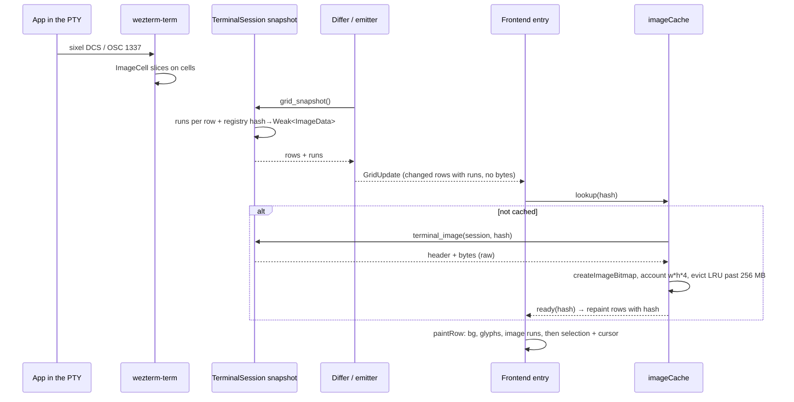

## Context

wezterm-term already turns sixel and iTerm2 inline images into per-cell slices (`ImageCell` on the cell attributes), and it already advertises sixel (DA1 `;4`, XTSMGRAPHICS). Nergal's snapshot reads only text attributes, so images never reach the canvas. Facts with `path:line` are in `implementation.md`; the full exploration is in `~/.claude/projects/-home-felipe-Projects-cluihud/work/terminal-images/analysis.md`.

User decisions (2026-11-24): FRI-600 is split into this change (static sixel and iTerm2), FRI-612 (animated GIF) and FRI-613 (kitty graphics). Each terminal caps decoded images at 256 MB and drops the least recently used. Images also show in the scrollback. Nergal does not set `TERM_PROGRAM`.

## Goals / Non-Goals

**Goals:**
- Sixel and iTerm2 inline images appear in the right cells, in the main terminal and in quake shells, live and in the scrollback.
- Image bytes cross the IPC once per terminal and image, never per frame.
- A large image does not block the paint loop; memory stays inside the budget.
- The placement wire format is ready for kitty (`z`, several runs per cell, optional ids), so FRI-613 adds to it without changing it.

**Non-Goals:**
- GIF animation (FRI-612): the first frame is drawn.
- Kitty graphics (FRI-613): `enable_kitty_graphics` stays false.
- iTerm2 `inline=0` downloads and a `TERM_PROGRAM` value.
- A backend memory budget: wezterm keeps its own 100 MB per-image cap and LRU of 16; scrollback expiry frees images.

## Flow

## Decisions

### D1. Placements are per-row runs, not per-cell fields

A row carries `images: ImageRun[]` (omitted when empty). A run groups adjacent cells that show contiguous horizontal slices of one image (the next cell's `top_left.x` equals the previous `bottom_right.x`, same `v` range, same `z`). wezterm assigns slices this way (`terminalstate/image.rs:159-217`), so a sixel or iTerm2 image becomes one run per row.

Alternatives:
- A per-cell image field on `CellSnapshot`. Rejected: an 80x24 image adds about 1,900 cell references per full resend, and every scroll tick resends the full viewport (`differ.invalidate()` in `terminal_scroll`).
- Whole-image placements (top-left cell + size). Rejected: an app can overwrite part of an image, and wezterm then drops only those cells' slices; per-row runs show exactly what remains.

### D2. Bytes come through a pull command with a raw response

`terminal_image(session_id, hash)` is an async command (sync commands run on the main thread, `pty.rs:111`). It clones the terminal's `Arc<Mutex<TerminalSession>>` and drops the global `session_ptys`/`instances` locks before touching the session, upgrades the `Weak` under the session mutex only, and builds the payload in `spawn_blocking`. It returns `tauri::ipc::Response` with a 9-byte header (kind u8, width u32 LE, height u32 LE) and the bytes. The hash is 64 lowercase hex characters (`{:02x}` per byte; wezterm's own `HexSlice` does not pad). The per-terminal registry maps hash to `Weak<ImageData>`, filled while the snapshot is built, so it never keeps an image alive after the emulator drops it. Dead entries are pruned when the registry is filled.

Alternatives:
- Push bytes on the grid channel. Rejected: the grid channel is JSON; bytes as a JSON number array are about 4x larger, and a reattach or a scroll would resend them.
- A second push channel for raw bytes. Rejected: the backend would have to track what each frontend still holds; with a pull, the frontend's cache decides, and an evicted image is simply fetched again.

### D3. Sixel pixels travel as raw RGBA

Sixel images are `Rgba8` in wezterm. They are sent as raw RGBA; iTerm2 images stay in their encoded form (`EncodedFile`) and the WebView decodes them. Encoded bytes come from any process that writes to the PTY (a `cat` of a hostile file, output over ssh), and they now reach WebKit's native decoders. The backend sniffs magic bytes and serves only PNG, JPEG and GIF (a WebP, which wezterm keeps encoded even when it downscales, returns an error; a JPEG or BMP that wezterm downscales arrives already decoded as `Rgba8`, kind 0); any other encoded format returns an error and its cells show text. This narrows the decoder surface to the three formats terminal image tools send.

Alternatives:
- PNG-encode sixel pixels in the backend. Rejected: a new direct dependency and CPU spent while holding the emulator lock, for a one-time transfer.

### D4. The frontend cache is per terminal, LRU by last draw, 256 MB

A pure module `imageCache.ts` owns: in-flight dedupe (one fetch per hash), the decoded bitmap map, byte accounting (`w*h*4`), a last-drawn tick per hash, and eviction of the least recently drawn entries past 256 MB (`bitmap.close()`). The cache is per terminal (the user set the budget per terminal), so closing a terminal releases its bitmaps at once. A decode failure is permanent for that hash while the cache lives: the hash is content-addressed, so the same bytes fail the same way. A transport failure (the command errors, e.g. the image is no longer held) is retried at most twice more, on later paints, then becomes permanent. Eviction never drops a hash that the current rows reference: the terminal passes the set of hashes in `rowImages` to the cache after every grid update (`setVisible`). Only unreferenced entries are evicted, least recently drawn first; while the visible set alone exceeds 256 MB the cache overshoots, and it trims as soon as an image stops being referenced. Paint passes are partial (`applyUpdate` repaints only touched rows), so "drawn in this pass" cannot stand for "on screen". An entry enters with the current draw tick, even when no row references it any more by the time its decode resolves. A hard ceiling of 512 MB (2× the budget) stops decoding new images even when referenced: no decode starts with 512 MB or more held, and no decode starts while another is in flight if it would pass 512 MB. One lone decode started below the ceiling may cross it, by at most one image (100 MB, wezterm's cap), so the worst case stays bounded. Bytes are reserved from the response header (both kinds carry the pixel size) when a decode starts, so concurrent decodes count toward the budget and the ceiling. A fetch retry happens at most once per grid update, from `setVisible`, never from the paint path. A hidden terminal releases its bitmaps (D4 revision 1, review): ten background sessions would otherwise each keep up to 256 MB. Hidden covers a background session, a terminal created in the background, and quake shells while the quake overlay is closed. After `dispose()`, a fetch that resolves skips the decode, and a decode that resolves closes its bitmap; neither notifies.

Alternatives:
- One global cache shared by all terminals. Rejected: the budget is per terminal, and per-terminal ownership makes release on close trivial.

### D5. Drawing order and decode

Image smoothing follows the scale (re-review): at 1:1 (within 1%) smoothing is off, because each row samples a fractional slice and bilinear sampling would bleed the neighbour row into a seam; when the image is scaled, smoothing is on and the source rect snaps to whole pixels, so downscaled photos do not alias. A run with a non-positive source or destination size is skipped, and `u`/`v` are clamped to 0..1. Runs with `z >= 0` are drawn after the glyphs and the underline of their row and before the selection and the cursor; runs with `z < 0` (kitty only, FRI-613) before the glyph loop; the per-cell background fills of that loop cover them today, and FRI-613 owns layering under text. Encoded files decode with `createImageBitmap(new Blob([bytes]), { imageOrientation: "none" })` (wezterm sized the cell span from the raw dimensions, so EXIF rotation would stretch the slices), RGBA with `createImageBitmap(new ImageData(...))`; both resolve off the paint path. When a bitmap is ready, the terminal repaints the rows whose runs reference it, then the selection and the cursor.

### D6. The sent-image state resets only on attach

The frontend cache lives with the terminal entry; the backend registry is per terminal. Nothing resets on scroll: `differ.invalidate()` resends rows (with their runs), and the frontend finds the hashes already cached.

## Risks / Trade-offs

- [Visible images alone exceed 256 MB] → the cache overshoots while referenced images alone exceed the budget and evicts only unreferenced entries.
- [Hostile output references many 100 MB images at once (e.g. one-row-tall, very wide images)] → hard ceiling of 2× the budget (512 MB): above it a new image is not decoded even when referenced; it counts as a transport failure (retryable once the visible set shrinks) and its cells show text.
- [Padding semantics] → runs carry wezterm's per-cell padding values and merge only cells whose left/top padding match; the destination uses the first cell's left padding and the last cell's right padding. Sixel and iTerm2 use zero padding. Kitty offsets (FRI-613) may need per-cell drawing; FRI-613 decides that.
- [Padding is fixed in pixels at placement time] → after a font zoom or a DPR change the padding no longer matches the new cell size; zero for sixel and iTerm2, so accepted; walk 4.5 zooms with an image on screen.
- [Wide characters before an image on the same row] → `col` is the terminal column (`cell_index()`), while `cells` skips wide-char continuations; the frontend positions runs by terminal column. Text and image positions on such rows follow the existing wide-char painting.
- [A huge sixel blocks the emulator while parsing] → already true today; wezterm rejects images over 100 MB; out of scope.
- [Copying a 100 MB image for the command] → it runs in `spawn_blocking` under the image's own mutex, never under the session mutex or the global PTY maps.
- [Resize reflow of image cells] → wezterm behavior unverified; walk step covers a resize with an image on screen.
- [The `terminal-wezterm` spec still names a `terminal:grid-update` event while the code uses a channel] → pre-existing drift; the new requirements name `GridUpdate` only.
